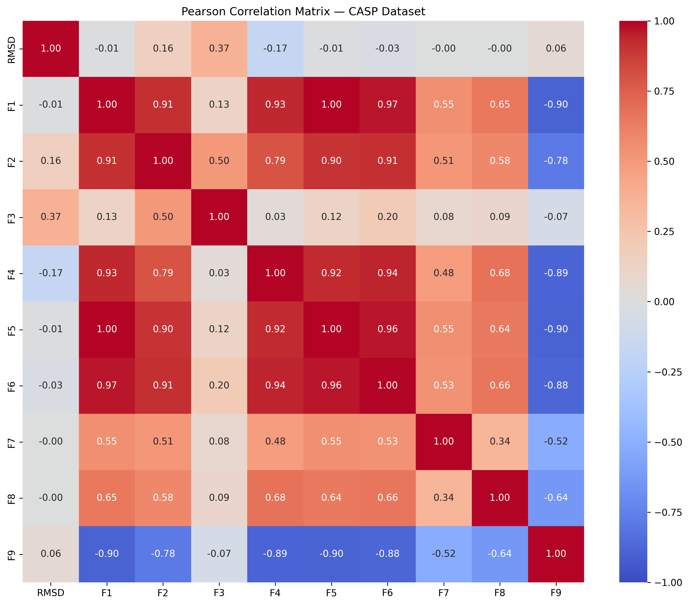
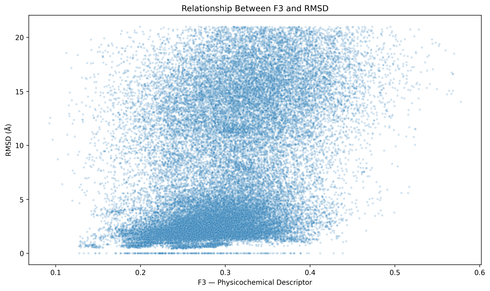
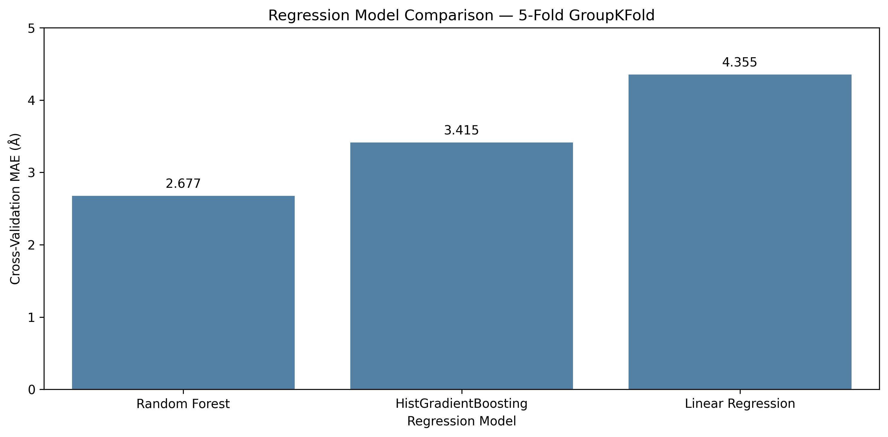
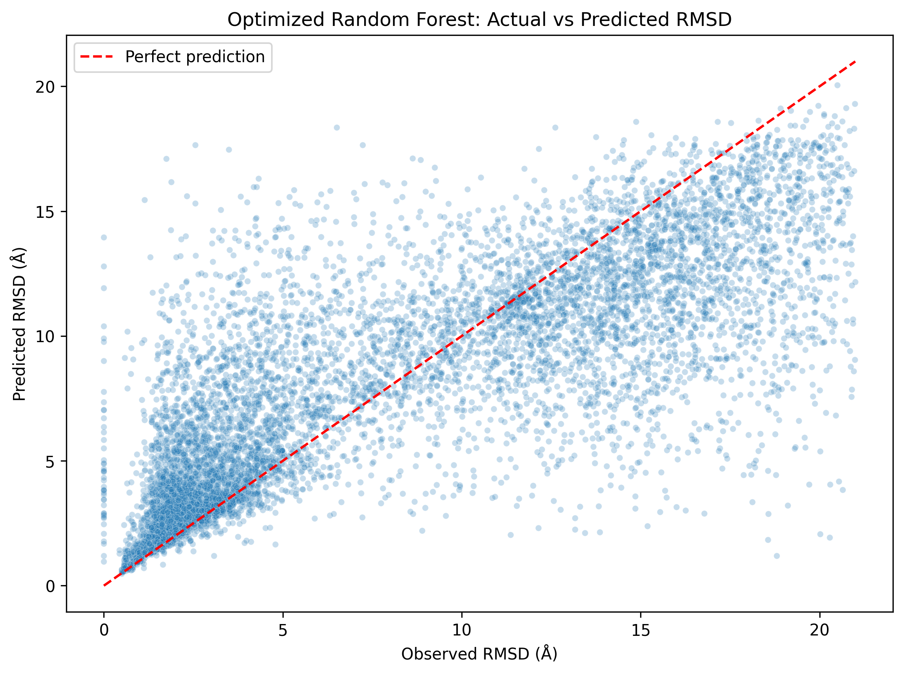
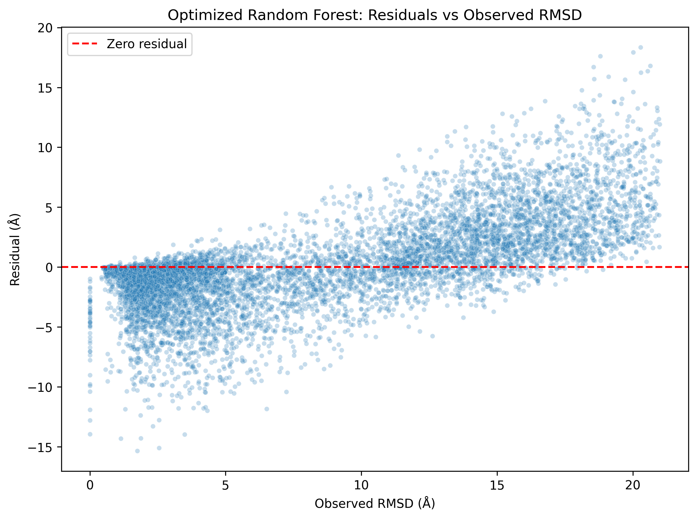
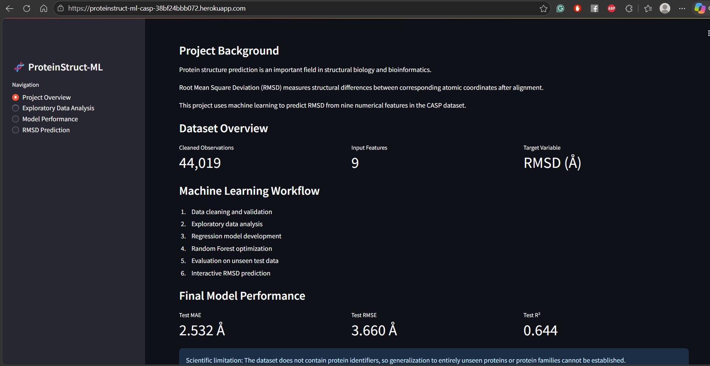
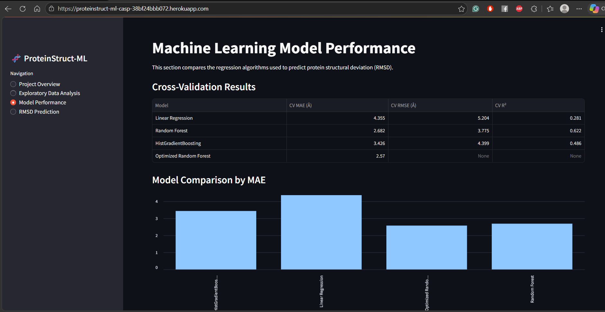
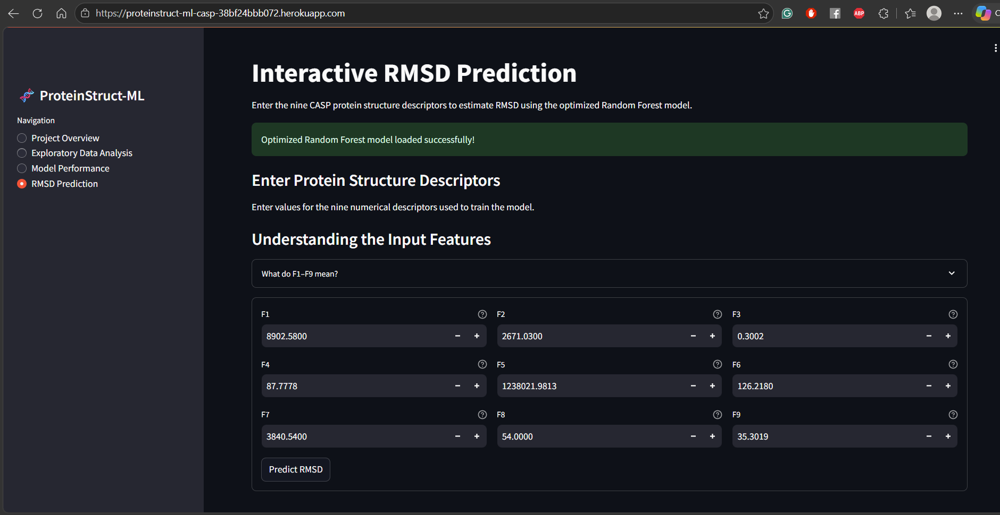

# 

# ProteinStruct-ML: Predicting Protein Structural Deviation Using Machine Learning

## Project Overview

Proteins are biological macromolecules involved in nearly every process occurring within living cells. Their functions depend not only on their amino acid sequences but also on the three-dimensional structures they adopt.

Understanding protein structure is therefore essential for investigating biological mechanisms, interpreting protein function, and supporting research in biotechnology, molecular biology, and drug discovery.

Experimentally determining protein structures can require substantial time and resources. Computational approaches provide an alternative by generating structural models, but these models can vary considerably in their accuracy.

Assessing the quality of predicted protein structures is consequently an important problem in structural bioinformatics.

This project investigates whether machine-learning algorithms can predict protein structural deviation using numerical descriptors associated with computational protein models.

The analysis uses the **CASP dataset**, which contains nine numerical input features (F1–F9) and a target variable representing structural deviation, expressed as Root Mean Square Deviation (RMSD).

The project follows a complete data-science workflow, including:

- data extraction, cleaning, and validation;
- exploratory data analysis and statistical testing;
- development and comparison of regression models;
- hyperparameter optimization and cross-validation;
- evaluation of predictive performance;
- and deployment of an interactive application using Streamlit and Heroku.

The final application allows users to explore the dataset, review model performance, and generate RMSD predictions from numerical input features.

## Understanding the Biological Context

### Protein Structure

Proteins consist of amino acids connected into polypeptide chains. These chains fold into three-dimensional structures that influence how proteins interact with other molecules and perform their biological functions.

Protein structure is commonly described at several organizational levels:

- **Primary structure:** The amino acid sequence.
- **Secondary structure:** Local structural arrangements such as alpha helices and beta sheets.
- **Tertiary structure:** The overall three-dimensional organization of a polypeptide chain.
- **Quaternary structure:** The arrangement of multiple polypeptide chains within a protein complex.

The three-dimensional organization of a protein is particularly important because changes in structural conformation can influence its biological activity.

### Experimental and Computational Protein Structures

Protein structures can be determined experimentally using techniques such as X-ray crystallography, nuclear magnetic resonance (NMR) spectroscopy, and cryogenic electron microscopy (cryo-EM).

Computational methods can also generate structural models based on amino acid sequences and other available information.

However, computational models are not necessarily identical to experimentally determined reference structures.

Evaluating the differences between predicted and reference structures is therefore important when assessing structural model quality.

### Root Mean Square Deviation (RMSD)

Root Mean Square Deviation is a commonly used measure of structural difference between corresponding atoms in two molecular structures.

After appropriate structural alignment, RMSD can be expressed as:

\[
\mathrm{RMSD} = \sqrt{\frac{1}{N}\sum_{i=1}^{N}\left\|\mathbf{r}_i-\mathbf{r}_i^{\mathrm{ref}}\right\|^2}
\]

where:

- \(N\) is the number of corresponding atoms;
- \(\mathbf{r}_i\) is the position of atom \(i\) in the evaluated structure;
- \(\mathbf{r}_i^{\mathrm{ref}}\) is the corresponding position in the reference structure.

RMSD is commonly expressed in ångströms (Å), where 1 Å equals 0.1 nanometres.

A smaller RMSD generally indicates greater structural similarity between the compared atomic coordinates, whereas a larger RMSD indicates greater structural deviation.

RMSD depends on the atoms selected, their correspondence, and the alignment procedure. It should therefore be interpreted in the context of how the structures were compared.

### Machine Learning for Structural Deviation Prediction

Machine learning provides methods for identifying statistical relationships between input variables and an outcome of interest.

In supervised regression, an algorithm learns from observations for which both the input features and the target values are known.

After training, the model can estimate the target variable for new observations.

In ProteinStruct-ML, the input consists of nine numerical descriptors (F1–F9), while RMSD is the continuous target variable.

The central question is whether these descriptors contain sufficient predictive information to estimate structural deviation with useful accuracy.

This project compares several regression approaches and evaluates their performance on data not used during model training.

## Project Objectives

The overall objective of ProteinStruct-ML is to investigate whether machine-learning algorithms can accurately estimate protein structural deviation (RMSD) using numerical descriptors from the CASP dataset.

The project combines exploratory statistical analysis with supervised machine learning to evaluate relationships between structural descriptors and RMSD.

The specific objectives are to:

1. **Prepare a reliable dataset:** Inspect the original CASP dataset for missing values, duplicate records, inconsistent data types, and potentially unusual observations.

2. **Explore structural descriptors:** Investigate the distributions of RMSD and the nine numerical features (F1–F9), identify extreme observations, and examine relationships between variables.

3. **Evaluate statistical relationships:** Use correlation analysis and hypothesis testing to determine whether selected descriptors are statistically associated with RMSD.

4. **Develop regression models:** Establish a baseline prediction using DummyRegressor and compare the performance of Linear Regression, Random Forest Regression, and HistGradientBoosting Regression.

5. **Optimize model performance:** Apply cross-validation and hyperparameter optimization to identify suitable model configurations.

## Research Questions

The project addresses five research questions:

1. **What are the main statistical characteristics of the CASP dataset?**

   How are RMSD and the nine numerical descriptors distributed? Are the variables approximately normally distributed, skewed, or affected by extreme observations?

2. **Which numerical descriptors are associated with RMSD?**

   Do the input features exhibit meaningful statistical relationships with structural deviation, and what do correlation analysis and hypothesis testing reveal about these associations?

3. **Can machine-learning algorithms predict RMSD more accurately than a simple baseline?**

   How do Linear Regression, Random Forest Regression, and HistGradientBoosting Regression perform compared with a baseline model that predicts a constant value?

4. **Does model optimization improve predictive performance?**

   Can cross-validation and hyperparameter tuning improve the predictive accuracy of the selected regression models?

5. **How reliably can the final model estimate RMSD for unseen observations?**

   What do the test-set MAE, RMSE, R², and residual analysis reveal about the model's accuracy, limitations, and potential generalization?

These questions provide the framework for interpreting the results of the ETL, EDA, and machine-learning notebooks.

## Dataset

The project uses the **CASP (Critical Assessment of protein Structure Prediction) protein tertiary structure dataset**.

CASP is an international initiative designed to evaluate computational methods for predicting protein three-dimensional structures.

The dataset contains numerical descriptors associated with computational protein models, together with a target variable representing their structural deviation.

The aim is to investigate whether relationships between these numerical descriptors and RMSD can be learned by regression algorithms.

### Dataset Structure

The original dataset contains **45,730 observations and 10 variables**.

| Variable | Description |
|---|---|
| `RMSD` | Root Mean Square Deviation, the continuous target variable |
| `F1` | Numerical input descriptor 1 |
| `F2` | Numerical input descriptor 2 |
| `F3` | Numerical input descriptor 3 |
| `F4` | Numerical input descriptor 4 |
| `F5` | Numerical input descriptor 5 |
| `F6` | Numerical input descriptor 6 |
| `F7` | Numerical input descriptor 7 |
| `F8` | Numerical input descriptor 8 |
| `F9` | Numerical input descriptor 9 |

The nine descriptors are supplied under generic feature names (F1–F9). Their precise physicochemical or structural interpretations are not established in the project notebooks, so no unsupported biological meaning is assigned to individual features.

### Target Variable: RMSD

RMSD is the variable the machine-learning models are trained to predict.

It represents a numerical measure of structural deviation and is expressed in ångströms (Å).

In general, lower RMSD values indicate greater similarity between the compared protein structures, whereas higher values indicate larger structural differences.

### Initial Dataset Characteristics

Initial inspection using Pandas revealed:

- **45,730 observations**
- **10 numerical variables**
- **9 predictor variables and 1 target variable**
- **No missing values**
- **Nine `float64` columns and one `int64` column (F8)**

The original RMSD values have the following descriptive statistics:

| Statistic | RMSD |
|---|---:|
| Mean | 7.75 Å |
| Median | 5.03 Å |
| Standard deviation | 6.12 Å |
| Minimum | 0.00 Å |
| Maximum | 21.00 Å |

The mean is higher than the median, suggesting a positively skewed RMSD distribution. This observation is investigated further during exploratory data analysis.

The numerical predictors also have substantially different scales. For example, F3 contains values below 1, while F5 contains values in the millions.

These differences are relevant when selecting preprocessing methods and machine-learning algorithms.

### Dataset Size After Cleaning

The data preparation process identified and removed 1,711 exact duplicate observations.

The cleaned dataset therefore contains **44,019 observations and 10 variables**.

The original dataset is stored in:

`data/raw/CASP.csv`

The cleaned dataset used for subsequent analysis is stored in:

`data/processed/casp_cleaned.csv`

Data Cleaning and Preparation

Before exploratory data analysis and machine-learning model development, the original CASP dataset was inspected and prepared in the 01_ETL.ipynb notebook.

The objective was to identify potential data-quality issues, investigate duplicate observations, and produce a validated dataset while preserving potentially meaningful scientific information.

1. Data Loading and Initial Inspection

The original dataset was loaded from data/raw/CASP.csv using Pandas.

Initial inspection included:

Displaying the first five observations using head().

Checking dataset dimensions using shape.

Examining data types and non-null counts using info().

Calculating descriptive statistics using describe().

The dataset contained 45,730 observations and 10 numerical columns, consisting of RMSD and nine predictor variables (F1–F9).

All columns contained non-null values. Nine columns had the float64 data type, while F8 was stored as int64.

Descriptive statistics revealed substantial differences in the scales of the predictors. Several variables also exhibited large differences between their median and maximum values, suggesting potentially extreme observations.

These characteristics were investigated further during exploratory data analysis.

2. Missing-Value Assessment

Missing values were checked using isnull().sum().

No missing values were detected in any of the ten variables.

Consequently, no missing-value imputation or row removal was necessary.

3. Investigation of Duplicate Observations

The dataset was examined for exact duplicate observations using duplicated().

The initial assessment identified:

Measure

Result

Original observations

45,730

Exact duplicates

1,711

Percentage duplicated

3.74%

Rows belonging to duplicate groups

3,162

Duplicate groups were inspected using duplicated(keep=False) and value_counts().

An additional investigation examined whether identical combinations of predictor values (F1–F9) were associated with different RMSD values.

This analysis identified 38 predictor combinations associated with more than one RMSD value.

These observations are not necessarily data-entry errors. They may reflect information not fully represented by the available numerical descriptors.

It was therefore important to distinguish between exact duplicate observations and observations with identical predictors but different target values.

4. Handling Duplicate Records

Only exact duplicate rows across all ten columns were removed using drop_duplicates().

This reduced the dataset from 45,730 to 44,019 observations.

The 38 predictor combinations associated with different RMSD values were retained.

Removing these observations would have required assuming that identical predictor values must correspond to identical RMSD values, which was not justified by the available information.

The original dataset was preserved separately.

No outlier removal, feature scaling, or additional transformations were performed during ETL.

5. Exporting the Cleaned Dataset

The cleaned dataset was exported to:

data/processed/casp_cleaned.csv

The original data remained available at:

data/raw/CASP.csv

Separating raw and processed data helps preserve reproducibility and allows the cleaning procedure to be reviewed independently.

6. Data Validation

After export, the cleaned CSV file was reloaded and checked.

The validation process confirmed:

Validation check

Result

Expected dimensions

44,019 × 10

Missing values

0

Exact duplicate observations

0

Expected column names

Preserved

Automated assertions

All passed

Automated assertions were used to verify dataset dimensions, missing-value counts, duplicate counts, and column consistency.

The cleaned dataset was subsequently used for exploratory data analysis and machine-learning model development.

Data Cleaning Conclusions

The ETL process removed 1,711 redundant observations while retaining records that shared predictor values but differed in RMSD.

The final dataset contained 44,019 observations and 10 numerical variables, with no missing values or exact duplicate records.

The investigation also highlighted the importance of considering repeated predictor combinations during machine-learning evaluation.

This finding motivated the use of group-aware data splitting and cross-validation in the modeling notebook to reduce the risk of information leakage between training and evaluation datasets.

## Exploratory Data Analysis

Exploratory Data Analysis (EDA) was performed in `02_EDA.ipynb` using the cleaned CASP dataset containing 44,019 observations.

The purpose of the analysis was to understand the statistical properties of RMSD and the nine numerical predictors (F1–F9), investigate potential outliers, examine relationships between variables, and identify considerations relevant to machine-learning model development.

The analysis included descriptive statistics, distribution plots, correlation analysis, and statistical hypothesis testing.

### 1. Distribution of RMSD

The first stage investigated the distribution of RMSD, the continuous target variable used for machine-learning regression.

A histogram with 50 bins and a kernel density estimate (KDE) was generated to visualize the frequency and distribution of RMSD values.


The histogram revealed a non-normal, apparently bimodal distribution, with two main concentrations of observations:

- A prominent concentration around 1.5–3 Å, representing relatively low structural deviations.
- A broader concentration around 14–16 Å, representing substantially higher structural deviations.

Fewer observations were present in the intermediate range of approximately 7–10 Å.

These observations suggest that the dataset contains distinct regions of structural deviation. However, the histogram alone does not establish the biological or computational reasons for this pattern.

#### Descriptive Statistics

The following statistics were calculated using Pandas:

| Statistic | Result |
|---|---:|
| Mean RMSD | 7.796 Å |
| Median RMSD | 5.087 Å |
| Standard deviation | 6.138 Å |
| Variance | 37.673 Ų |
| Skewness | 0.553 |
| Excess kurtosis | −1.162 |
| Observations with RMSD below 5 Å | 49.6% |

The mean RMSD is higher than the median, consistent with the moderately positive skewness of 0.553.

The standard deviation of 6.138 Å indicates substantial variability in structural deviation across the dataset.

The negative excess kurtosis indicates lower kurtosis than a normal distribution.

The empirical probability of observing RMSD below 5 Å was approximately 49.6%. This means that almost half of the observations had RMSD values below this threshold.

#### Implications for Machine Learning

The distribution of RMSD has several implications for predictive modeling.

First, the model must learn relationships across a broad range of structural deviations.

Second, prediction errors may vary between low-RMSD and high-RMSD observations. Therefore, overall evaluation metrics should be interpreted alongside residual analysis.

Third, the apparent bimodality suggests that a single linear relationship may not adequately describe the variation in RMSD.

These observations support comparing a simple linear regression model with more flexible nonlinear algorithms, including Random Forest and HistGradientBoosting Regression.

No target transformation was performed during exploratory analysis. The original RMSD values were retained for subsequent modeling.

### 2. Distribution of Input Features (F1–F9)

The nine numerical predictor variables (F1–F9) were examined to understand their distributions, variability, and potential extreme values.

These descriptors represent numerical characteristics associated with protein structural models in the CASP dataset. Their individual scientific definitions are not provided in the project dataset.

Understanding the distributions of these variables is important because their numerical scales, asymmetry, and extreme observations may influence machine-learning performance.

#### Visualization of Feature Distributions

Histograms with kernel density estimates (KDE) were generated for all nine predictors using Seaborn and Matplotlib.

The histograms were arranged in a **3 × 3 grid**, allowing direct comparison of the distributional characteristics of F1–F9.


*Figure: Distribution of the nine numerical descriptors (F1–F9) in the cleaned CASP dataset. Each histogram displays the frequency of observed values, while the KDE curve provides a smoothed representation of the distribution.*

#### Key Findings

The exploratory analysis revealed considerable differences between the distributions of the nine predictors.

**1. Right-Skewed Distributions**

Seven predictors — F1, F2, F4, F5, F6, F7, and F8 — exhibited varying degrees of positive skewness.

This indicates that their distributions have longer right-hand tails, with some observations substantially exceeding the values found in the main concentration of the data.

**2. Approximately Symmetric Distribution**

F3 exhibited a roughly bell-shaped distribution, suggesting a more balanced spread of observations around its central region.

**3. Complex Distribution**

F9 displayed an asymmetric distribution with multiple shoulders, indicating a more complex pattern than a simple symmetric distribution.

**4. Potential Extreme Values**

F7 contained particularly large upper-tail observations, with its maximum value exceeding 100,000.

These observations warranted further investigation to determine their frequency and potential implications for modeling.

#### Implications for Machine Learning

The differences between predictor distributions have several implications:

- **Feature scaling:** Predictors have substantially different numerical ranges. Standardization may benefit algorithms that are sensitive to feature scale.
- **Extreme values:** Unusually large observations can influence certain regression algorithms and may require further investigation.
- **Algorithm selection:** Tree-based algorithms, including Random Forest and HistGradientBoosting, are generally less sensitive to feature scaling than many distance-based or regularized models.
- **Feature transformations:** Transformations may be considered where appropriate, but should be evaluated within the training pipeline to avoid data leakage.
- **Data preservation:** Extreme observations should not automatically be removed without evidence that they represent errors.

No observations were removed solely because of their distributional characteristics.

The particularly large values observed in F7 were investigated separately in the next stage of exploratory analysis.

### 3. Investigation of Extreme Values in F7

The distribution analysis identified F7 as a descriptor containing particularly large values in its upper tail.

To investigate these observations, a more detailed statistical analysis was performed using percentiles and threshold-based counts.

The objective was to determine the extent of the extreme values and assess whether they should be retained for subsequent machine-learning development.

#### Statistical Investigation

The following percentiles were calculated using the Pandas `quantile()` method.

| Percentile | F7 Value |
|---|---:|
| 50th (Median) | 3,840.54 |
| 90th | 5,371.42 |
| 95th | 5,759.71 |
| 99th | 7,244.05 |
| 99.9th | 19,873.50 |
| Maximum | 105,948.17 |

The results indicate that most F7 values are concentrated within a substantially narrower range than the maximum observation.

For example, 99% of observations have F7 values at or below approximately 7,244, while the maximum reaches 105,948.

The maximum value is approximately **27.6 times greater than the median**, demonstrating the presence of an exceptionally long upper tail.

#### Frequency of Extreme Observations

To determine how frequently unusually large values occur, observations exceeding two thresholds were counted.

| Threshold | Number of Observations | Percentage of Dataset |
|---|---:|---:|
| F7 > 10,000 | 267 | 0.61% |
| F7 > 20,000 | 43 | 0.10% |

Only a small fraction of the dataset contains these extreme values.

Although uncommon, their presence may influence certain statistical and machine-learning algorithms.

#### Interpretation and Data Quality Considerations

An extreme numerical value is not necessarily an erroneous observation.

In scientific datasets, unusually large values may represent genuine variation, measurement artifacts, computational effects, or data-processing errors.

However, the available CASP dataset does not provide sufficient information to determine the scientific validity of individual extreme F7 observations.

Consequently, removing these records solely because they are statistically unusual would not be justified.

#### Implications for Machine Learning

Extreme values may affect regression algorithms differently.

- **Linear Regression:** Unusual predictor values can have high leverage and may substantially influence the fitted relationship.
- **Random Forest Regression:** Decision trees partition the feature space using thresholds and are generally less sensitive to numerical scaling.
- **HistGradientBoosting Regression:** Histogram-based feature binning can reduce sensitivity to the magnitude of extreme predictor values, although unusual observations may still influence predictions.

Potential transformations or robust preprocessing methods could be evaluated during model development if necessary.

Any preprocessing parameters learned from the data should be fitted using the training data only, avoiding information leakage into validation or test sets.

#### Final Decision

**All extreme F7 observations were retained in the cleaned dataset.**

No outlier removal or feature transformation was performed during the ETL or exploratory analysis stages.

This decision preserves the original numerical information while allowing the machine-learning models to be evaluated on the observed feature distributions.

### 4. Pearson Correlation Analysis

Correlation analysis was performed to investigate linear relationships between the nine numerical descriptors (F1–F9) and RMSD, as well as relationships among the predictors themselves.

Understanding these relationships is important for identifying potentially informative predictors, detecting multicollinearity, and guiding machine-learning model selection.

#### Pearson Correlation Matrix

The Pearson correlation coefficient measures the direction and strength of a linear relationship between two numerical variables.

Its values range from −1 to +1:

- **+1:** Perfect positive linear relationship.
- **0:** No linear relationship.
- **−1:** Perfect negative linear relationship.

A correlation matrix was calculated using Pandas and visualized as a heatmap using Seaborn.



*Figure: Pearson correlation matrix for RMSD and the nine numerical descriptors (F1–F9). Red indicates positive correlations, blue indicates negative correlations, and values close to zero indicate weak linear associations.*

#### Relationships Between Predictors and RMSD

The Pearson correlation analysis produced the following results:

| Predictor | Pearson Correlation with RMSD |
|---|---:|
| F3 | 0.3734 |
| F4 | −0.1693 |
| F2 | 0.1584 |
| F9 | 0.0619 |
| F6 | −0.0344 |
| F1 | −0.0131 |
| F5 | −0.0120 |
| F7 | −0.0031 |
| F8 | −0.00003 |

F3 exhibited the strongest individual positive linear association with RMSD (r = 0.3734).

This indicates that higher F3 values tend to be associated with higher RMSD values, although the relationship is far from deterministic.

F4 showed a weak negative correlation (r = −0.1693), while F2 exhibited a weak positive correlation (r = 0.1584).

The remaining descriptors demonstrated weak or negligible individual linear correlations with RMSD.

However, weak Pearson correlations do not necessarily indicate that a predictor lacks predictive value.

Nonlinear relationships and interactions between multiple descriptors may contribute information that cannot be identified through individual Pearson correlation coefficients.

#### Multicollinearity Among Predictors

The correlation matrix also revealed strong relationships between several input variables.

| Predictor Pair | Pearson Correlation |
|---|---:|
| F1 and F5 | Approximately +1.00 |
| F1 and F6 | +0.97 |
| F5 and F6 | +0.96 |
| F4 and F6 | +0.94 |
| F1 and F9 | −0.90 |

These results indicate substantial multicollinearity among several descriptors.

Multicollinearity occurs when two or more predictors contain strongly overlapping linear information.

This can complicate the interpretation of individual regression coefficients because it becomes difficult to separate the contributions of highly correlated variables.

For example, F1 and F5 exhibit an almost perfect positive correlation, suggesting considerable redundancy in their numerical variation.

However, strong correlation alone does not establish that either variable should be removed.

#### Implications for Machine Learning

The correlation analysis provides several insights for model development:

1. **Linear Regression:** A useful benchmark for investigating linear relationships, although multicollinearity may affect coefficient stability and interpretation.

2. **Random Forest Regression:** Can capture nonlinear relationships and interactions between predictors without requiring a linear relationship with RMSD.

3. **HistGradientBoosting Regression:** Provides another nonlinear modeling approach capable of learning more complex relationships.

4. **Feature Selection:** Highly correlated predictors may contain redundant information, but removing them should be justified by validation performance rather than correlation alone.

5. **Predictive Interpretation:** Individual correlations describe associations, not causal relationships or the complete predictive contribution of each feature.

#### Conclusion

F3 demonstrated the strongest individual linear association with RMSD, while substantial multicollinearity was observed among several other predictors.

These findings support comparing linear regression with nonlinear ensemble methods to determine whether more complex relationships improve predictive performance.

**All nine predictors were retained for the initial machine-learning experiments.**

### 5. Relationship Between F3 and RMSD

Following the Pearson correlation analysis, the relationship between F3 and RMSD was investigated in greater detail.

F3 was selected because it exhibited the strongest individual linear correlation with RMSD among the nine numerical descriptors (r = 0.3734).

A scatter plot was generated using Seaborn to visualize the relationship between F3 values and the corresponding structural deviations.

#### Visualization of F3 and RMSD



*Figure: Scatter plot showing the relationship between F3 and RMSD in the cleaned CASP dataset. Each point represents an observation. Transparency was applied to improve visualization in regions with overlapping observations.*

#### Key Findings

The scatter plot revealed a complex relationship between F3 and RMSD.

Although a moderate positive correlation was observed, the data points showed considerable dispersion.

Two broad concentrations of RMSD values were visible, consistent with the apparently bimodal distribution identified during the initial target-variable analysis.

Furthermore, observations with similar F3 values frequently exhibited substantially different RMSD values.

This indicates that F3 alone cannot adequately explain the variability in protein structural deviation.

The relationship also does not appear to follow a simple linear pattern.

#### Implications for Machine Learning

These observations suggest several important considerations:

- **Linear relationships:** F3 provides some information about RMSD, but its individual linear association is insufficient to explain most of the variation.
- **Nonlinear relationships:** More flexible algorithms may capture patterns that are not represented by a simple linear regression.
- **Feature interactions:** Combining F3 with other descriptors may improve predictive performance.
- **Model evaluation:** The relative performance of linear and nonlinear algorithms must be determined experimentally using appropriate validation procedures.

#### Conclusion

F3 is the predictor with the strongest individual linear association with RMSD in this dataset.

However, the scatter plot demonstrates that the relationship contains substantial variability and cannot be adequately described using F3 alone.

This finding provides further motivation for evaluating multivariable regression models, including Random Forest and HistGradientBoosting.

### 6. Statistical Hypothesis Testing — F3 and RMSD

Following the exploratory correlation analysis, a formal statistical hypothesis test was performed to determine whether the observed association between F3 and RMSD was statistically significant.

The analysis was conducted using Pearson's correlation test from the SciPy library.

#### Research Question

**Is there a statistically significant linear association between descriptor F3 and RMSD?**

#### Null and Alternative Hypotheses

Two hypotheses were formulated:

- **Null hypothesis (H₀):** There is no linear correlation between F3 and RMSD in the underlying population (ρ = 0).
- **Alternative hypothesis (H₁):** There is a nonzero linear correlation between F3 and RMSD in the underlying population (ρ ≠ 0).

A two-sided statistical test was performed using a significance level of α = 0.05.

The decision rule was:

- If p < 0.05, reject the null hypothesis.
- If p ≥ 0.05, fail to reject the null hypothesis.

#### Statistical Method

The Pearson correlation test was implemented using SciPy:

```python
from scipy.stats import pearsonr

r_value, p_value = pearsonr(df["F3"], df["RMSD"])
```

This function calculates the Pearson correlation coefficient and evaluates the statistical evidence against the null hypothesis of zero population correlation.

#### Hypothesis Test Results

| Statistical Measure | Result |
|---|---|
| Pearson correlation coefficient | 0.3734 |
| P-value | Extremely small (displayed as 0.000e+00) |
| Significance level | 0.05 |
| Statistical decision | Reject H₀ |
| Direction of association | Positive |
| Squared correlation coefficient (r²) | Approximately 0.139 |

The p-value was considerably smaller than the significance threshold of 0.05.

Therefore, the null hypothesis of zero population correlation was rejected under the assumptions of the Pearson correlation test.

The reported p-value of 0.000e+00 reflects numerical underflow and should not be interpreted as a mathematically exact probability of zero.

#### Interpretation of the Results

The Pearson correlation coefficient of 0.3734 indicates a moderate positive linear association between F3 and RMSD.

In general, higher F3 values tend to be associated with higher RMSD values.

However, the correlation is not sufficiently strong to explain most of the observed variability in RMSD.

The squared correlation coefficient provides an additional interpretation:

**r² = 0.3734² ≈ 0.139**

This indicates that a simple linear regression model using F3 alone, with an intercept, would explain approximately 13.9% of the observed RMSD variance in the analyzed dataset.

Consequently, approximately 86.1% of the variance would remain unexplained by that single-predictor linear model.

This supports investigating additional descriptors and more flexible machine-learning algorithms.

#### Statistical Limitations

Several limitations must be considered when interpreting these findings.

**1. Statistical significance does not imply causation**

The observed association does not establish that F3 directly influences protein structural deviation.

**2. Large sample size**

The dataset contains 44,019 observations. With such a large sample, even moderate correlations can produce extremely small p-values.

Therefore, statistical significance should be distinguished from predictive usefulness.

**3. Independence of observations**

The CASP dataset does not provide protein identifiers that would allow the independence of observations to be fully verified.

Related protein models may be represented in the dataset, potentially violating the independence assumption of the Pearson correlation test.

Consequently, the reported p-value should be interpreted cautiously.

**4. Linear association only**

Pearson's correlation coefficient measures linear relationships.

It does not capture all possible nonlinear relationships or interactions between multiple predictors.

#### Conclusion

The hypothesis test identified a statistically significant positive association between F3 and RMSD under the test assumptions.

However, the moderate correlation and limited explanatory power of F3 alone indicate that additional predictors and potentially nonlinear relationships should be investigated.

These findings provide statistical motivation for the subsequent machine-learning experiments using Linear Regression, Random Forest Regression, and HistGradientBoosting Regression.

### 7. EDA Summary and Implications for Machine Learning

The exploratory analysis of the cleaned CASP dataset provided several important insights into the statistical characteristics of protein structural deviation and its numerical predictors.

#### Summary of Key Findings

| Analysis | Key Finding | Implication |
|---|---|---|
| RMSD distribution | Non-normal, apparently bimodal distribution | Models must predict a broad range of structural deviations |
| Feature distributions | Several predictors exhibit positive skewness | Different feature scales and distributions should be considered |
| F7 extreme values | Maximum of approximately 105,948 | Extreme observations may influence certain algorithms |
| Pearson correlation | F3 has the strongest individual correlation with RMSD (r = 0.3734) | F3 provides useful but limited linear predictive information |
| Multicollinearity | Strong correlations among F1, F5, and F6 | Linear regression coefficients may be difficult to interpret |
| F3–RMSD scatter plot | Substantial variability around the positive association | Additional features and nonlinear relationships may be important |
| Hypothesis testing | Statistically significant positive association between F3 and RMSD | Statistical significance does not necessarily imply strong predictive performance |

#### Implications for Model Development

Based on these findings, the subsequent modeling stage was designed to compare regression algorithms with different levels of complexity.

**Linear Regression** provides an interpretable benchmark for evaluating whether a linear combination of the nine descriptors can adequately predict RMSD.

**Random Forest Regression** can model nonlinear relationships and interactions between predictors without requiring feature standardization.

**HistGradientBoosting Regression** provides an alternative ensemble-learning approach capable of capturing complex patterns through sequentially constructed decision trees.

The analysis also emphasizes the importance of evaluating model performance on unseen data rather than relying solely on correlations observed during EDA.

#### Final EDA Conclusions

The exploratory analysis demonstrated that RMSD prediction is a challenging regression problem characterized by heterogeneous target values, asymmetric feature distributions, substantial predictor correlations, and potentially nonlinear relationships.

All nine numerical predictors were retained for the initial modeling experiments, and extreme observations were preserved.

The next stage focuses on establishing baseline performance, training multiple regression algorithms, optimizing hyperparameters, and evaluating predictive accuracy using appropriate validation strategies.

## Machine Learning Modeling

Machine-learning development was performed in `03_Modeling.ipynb` using the cleaned CASP dataset.

The objective was to develop and evaluate regression models capable of predicting protein structural deviation (RMSD) from nine numerical descriptors (F1–F9).

The modeling workflow included baseline evaluation, linear and nonlinear regression, group-aware cross-validation, hyperparameter optimization, independent test evaluation, and model serialization.

### 1. Problem Definition and Data Preparation

#### Machine Learning Task

The project addresses a **supervised regression problem**, in which the objective is to predict a continuous numerical outcome.

The target variable is Root Mean Square Deviation (RMSD), expressed in ångströms (Å).

RMSD measures structural differences between a protein model and a reference structure. Lower values generally indicate closer structural agreement, while higher values indicate greater deviation.

The input variables are nine numerical descriptors, F1–F9, provided in the CASP dataset.

The model does not predict three-dimensional protein coordinates or generate new protein structures. Instead, it estimates RMSD from existing numerical descriptors.

#### Feature and Target Selection

The cleaned dataset was loaded from:

`data/processed/casp_cleaned.csv`

The feature matrix and target vector were defined using Pandas:

```python
feature_columns = [f"F{i}" for i in range(1, 10)]

X = df[feature_columns].copy()
y = df["RMSD"].copy()
```

The dataset contains:

| Component | Description |
|---|---|
| Total observations | 44,019 |
| Input features (X) | F1–F9 |
| Number of predictors | 9 |
| Target variable (y) | RMSD |
| Prediction task | Supervised regression |

All nine predictors were retained following the exploratory analysis.

#### Group-Aware Training and Test Split

To evaluate predictive performance on unseen observations, the dataset was divided into approximately 80% training data and 20% testing data.

Instead of using a conventional random split, the project implemented `GroupShuffleSplit` from scikit-learn.

This decision was motivated by the ETL findings, which identified some records with identical combinations of predictor values but different RMSD values.

If identical predictor combinations appeared in both training and testing datasets, the evaluation could benefit from information already encountered during training.

To reduce this risk, identical combinations of F1–F9 values were assigned the same group identifier.

```python
from sklearn.model_selection import GroupShuffleSplit

groups = pd.util.hash_pandas_object(X, index=False)

splitter = GroupShuffleSplit(n_splits=1, test_size=0.20, random_state=42)

train_idx, test_idx = next(splitter.split(X, y, groups=groups))
```

The resulting indices were used to create the training and testing subsets.

**The test dataset was reserved for final model evaluation and was not used for hyperparameter optimization.**

#### Verification of Group Separation

An explicit validation check was implemented to verify that identical predictor combinations did not cross the training/test boundary.

```python
train_groups = set(groups.iloc[train_idx])
test_groups = set(groups.iloc[test_idx])

assert train_groups.isdisjoint(test_groups)
```

The notebook reported:

`Group leakage check: PASSED`

This confirmed that no group identifier appeared in both subsets.

#### Why Group-Aware Splitting Matters

A conventional random split assumes that observations can be assigned independently to training and testing datasets.

However, this assumption can be problematic when multiple observations share identical predictor combinations.

Group-aware splitting reduces the risk of evaluating a model on predictor combinations already present in the training dataset.

Nevertheless, an important limitation remains: the CASP dataset used in this project does not contain protein identifiers or protein-family annotations.

Therefore, the grouping strategy does not guarantee separation between biologically related proteins.

The resulting evaluation measures generalization to held-out predictor combinations rather than demonstrating generalization to entirely unseen protein families.

#### Reproducibility

The split was configured with `random_state=42` to ensure reproducibility.

All subsequent model development and cross-validation procedures used the training dataset, while the held-out test dataset was preserved for final evaluation.

### 2. Baseline Model — DummyRegressor

Before developing predictive machine-learning models, a baseline was established using `DummyRegressor` from scikit-learn.

A baseline provides a reference level of predictive performance against which more sophisticated regression algorithms can be compared.

The purpose was to determine whether models trained on the nine numerical descriptors (F1–F9) could outperform a simple prediction strategy that does not learn relationships between the input features and RMSD.

#### Baseline Strategy

The `DummyRegressor` was configured using the `mean` strategy.

This approach calculates the average RMSD in the training dataset and uses that value as the prediction for every observation, regardless of its feature values.

The model therefore does not learn relationships between F1–F9 and RMSD.

It provides a simple benchmark representing constant-mean prediction.

#### Model Implementation

The baseline model was implemented using scikit-learn:

```python
from sklearn.dummy import DummyRegressor

dummy_model = DummyRegressor(strategy="mean")

dummy_model.fit(X_train, y_train)

y_train_pred_dummy = dummy_model.predict(X_train)
```

The model was trained and evaluated using the training dataset.

#### Evaluation Metrics

Three complementary regression metrics were used to evaluate predictive performance.

**Mean Absolute Error (MAE)**

MAE measures the average absolute difference between observed and predicted RMSD values.

\[
MAE = \frac{1}{n}\sum_{i=1}^{n}|y_i-\hat{y}_i|
\]

MAE is expressed in ångströms (Å), making it directly interpretable in the context of protein structural deviation.

Lower values indicate better predictive accuracy.

**Root Mean Squared Error (RMSE)**

RMSE measures the square root of the average squared prediction error.

\[
RMSE = \sqrt{\frac{1}{n}\sum_{i=1}^{n}(y_i-\hat{y}_i)^2}
\]

Because errors are squared before averaging, RMSE penalizes large prediction errors more strongly than MAE.

This is useful for identifying models that occasionally make particularly inaccurate RMSD predictions.

RMSE is also expressed in ångströms.

**Coefficient of Determination (R²)**

R² measures how well the model explains variation in the target variable relative to a constant-mean prediction.

\[
R^2 = 1-\frac{\sum_{i=1}^{n}(y_i-\hat{y}_i)^2}{\sum_{i=1}^{n}(y_i-\bar{y})^2}
\]

An R² value of 1 indicates perfect predictions.

An R² value of 0 indicates performance equivalent to predicting the mean of the evaluated target values.

Negative values indicate performance worse than this reference.

#### Baseline Training Results

The DummyRegressor produced the following results on the training dataset:

| Metric | DummyRegressor |
|---|---:|
| Mean predicted RMSD | 7.766 Å |
| MAE | 5.511 Å |
| RMSE | 6.137 Å |
| R² | 0.000 |

The model predicted a constant RMSD value of approximately 7.766 Å for every training observation.

The MAE of 5.511 Å indicates that predictions differed from the observed RMSD values by approximately 5.5 Å on average.

The RMSE of 6.137 Å reflects the substantial variability of RMSD values around the training-set mean.

The R² value of zero is expected because the model predicts the training-set mean and does not explain additional variation in RMSD.

#### Interpretation

The baseline demonstrates the limitations of predicting protein structural deviation without considering the numerical descriptors.

Although the model captures the overall average RMSD, it cannot distinguish between observations with relatively low and high structural deviations.

Consequently, it provides no observation-specific predictive information.

To demonstrate meaningful predictive performance, subsequent regression models should achieve lower prediction errors and higher R² values than this baseline.

However, training-set improvements alone are insufficient to establish generalization. Model comparisons should also use cross-validation and, ultimately, an independent held-out test dataset.

#### Conclusion

The DummyRegressor established a simple reference point for the machine-learning workflow.

Its training performance was:

- **MAE:** 5.511 Å
- **RMSE:** 6.137 Å
- **R²:** 0.000

These results provide a benchmark for evaluating whether Linear Regression and nonlinear ensemble models can learn useful relationships between F1–F9 and RMSD.

### 3. Linear Regression

Linear Regression was implemented as the first machine-learning model capable of learning relationships between the nine numerical descriptors (F1–F9) and the target variable, RMSD.

Unlike DummyRegressor, which predicts a constant value, Linear Regression estimates coefficients describing how the predictors are linearly associated with RMSD.

The objective was to establish whether a linear combination of the numerical descriptors could improve predictive accuracy compared with the baseline.

#### Model Principle

Multiple Linear Regression estimates the target variable using the following equation:

\[
\widehat{RMSD} = \beta_0 + \beta_1F_1 + \beta_2F_2 + \cdots + \beta_9F_9
\]

Where:

- \(\widehat{RMSD}\) is the predicted structural deviation.
- \(\beta_0\) is the intercept.
- \(\beta_1\) to \(\beta_9\) are the regression coefficients.
- \(F_1\) to \(F_9\) are the numerical input descriptors.

The model estimates its coefficients by minimizing the sum of squared prediction errors.

#### Preprocessing and Pipeline Implementation

The model was implemented using a scikit-learn `Pipeline` consisting of two steps:

1. **StandardScaler:** Standardizes the numerical predictors by subtracting the training mean and dividing by the training standard deviation.
2. **LinearRegression:** Fits a linear relationship between the standardized predictors and RMSD.

Standardization transforms a feature according to:

\[
z = \frac{x-\mu}{\sigma}
\]

Where \(\mu\) and \(\sigma\) are estimated from the training data.

Although ordinary least-squares Linear Regression does not inherently require standardized predictors, scaling helps place the variables on comparable numerical scales.

It can also improve numerical conditioning when features have substantially different magnitudes.

The pipeline was implemented as follows:

```python
from sklearn.pipeline import Pipeline
from sklearn.preprocessing import StandardScaler
from sklearn.linear_model import LinearRegression

linear_pipeline = Pipeline(
    [("scaler", StandardScaler()), ("model", LinearRegression())]
)

linear_pipeline.fit(X_train, y_train)

y_train_pred_linear = linear_pipeline.predict(X_train)
```

Using a pipeline ensures that preprocessing is fitted on the training data rather than on the entire dataset.

During subsequent cross-validation, the scaler is fitted separately within each training fold, helping prevent preprocessing-related data leakage.

#### Training Performance

The Linear Regression model was initially evaluated on the training dataset using Mean Absolute Error (MAE), Root Mean Squared Error (RMSE), and the coefficient of determination (R²).

| Metric | DummyRegressor | Linear Regression |
|---|---:|---:|
| MAE | 5.511 Å | 4.353 Å |
| RMSE | 6.137 Å | 5.201 Å |
| R² | 0.000 | 0.282 |

Linear Regression improved performance compared with the constant-mean baseline.

The MAE decreased from 5.511 Å to 4.353 Å, representing an improvement of approximately **21.0%**.

The RMSE decreased from 6.137 Å to 5.201 Å, representing an improvement of approximately **15.3%**.

The R² value increased from 0.000 to 0.282.

This indicates that the linear model explained approximately 28.2% of the observed variance in RMSD within the training dataset.

#### Interpretation

The improvement over DummyRegressor demonstrates that the numerical descriptors contain useful predictive information.

However, approximately 71.8% of the training-set variance remained unexplained by the fitted linear model.

The exploratory analysis had previously identified substantial multicollinearity among several descriptors, as well as possible nonlinear relationships with RMSD.

Multicollinearity can make individual regression coefficients difficult to interpret reliably, even when the model provides useful predictions.

Furthermore, Linear Regression cannot directly capture nonlinear effects or feature interactions unless these relationships are explicitly represented through additional transformed features.

These limitations motivate evaluating more flexible regression algorithms.

#### Conclusion

Linear Regression substantially outperformed the DummyRegressor baseline, demonstrating that the input descriptors provide meaningful predictive information.

Nevertheless, its relatively modest R² indicates that a simple linear combination of F1–F9 cannot explain most of the variation in RMSD.

The next stage evaluates model generalization using group-aware cross-validation before comparing Linear Regression with nonlinear ensemble methods.

### 4. Group-Aware Cross-Validation

Following the initial training evaluation, group-aware cross-validation was implemented to assess how well the regression models generalize to unseen observations.

Evaluating a model exclusively on the data used for training can produce overly optimistic results because the model has already encountered those observations.

Cross-validation provides a more reliable estimate of predictive performance by repeatedly training and validating a model on different subsets of the available training data.

#### Why Group-Aware Cross-Validation?

During the ETL stage, some observations were found to contain identical F1–F9 predictor combinations, occasionally associated with different RMSD values.

Using conventional K-fold cross-validation could allow identical predictor combinations to appear in both training and validation subsets.

To reduce this risk, `GroupKFold` from scikit-learn was used.

Each unique combination of F1–F9 values was assigned a group identifier.

GroupKFold ensures that all observations belonging to the same group remain together within each validation split.

This provides a more stringent evaluation than randomly distributing observations across folds.

#### Five-Fold Cross-Validation

The training dataset was divided into five group-aware folds.

During each iteration:

1. Four folds were used to train the regression model.
2. The remaining fold was used for validation.
3. Prediction errors were calculated on the validation fold.
4. The process was repeated until every fold had served as the validation subset.

The resulting validation scores were averaged to estimate model performance.

The independent test dataset was excluded from this procedure.

#### Implementation

The cross-validation strategy was implemented using scikit-learn:

```python
from sklearn.model_selection import GroupKFold, cross_validate

train_groups = groups.iloc[train_idx]

group_cv = GroupKFold(n_splits=5)

linear_cv = cross_validate(
    linear_pipeline,
    X_train,
    y_train,
    groups=train_groups,
    cv=group_cv,
    scoring={
        "MAE": "neg_mean_absolute_error",
        "RMSE": "neg_root_mean_squared_error",
        "R2": "r2",
    },
    n_jobs=-1,
)
```

The `cross_validate()` function evaluated the Linear Regression pipeline using three complementary regression metrics.

Scikit-learn returns negative values for MAE and RMSE because its scoring framework assumes that higher scores are preferable.

The signs were reversed when reporting these error metrics so that lower positive values represent better predictive performance.

Because `StandardScaler` was included inside the Linear Regression pipeline, the scaler was fitted separately on the training portion of each fold.

This prevents validation observations from influencing the preprocessing parameters.

#### Linear Regression Cross-Validation Results

The five-fold cross-validation produced the following mean results:

| Evaluation Metric | Training Performance | Cross-Validation Mean |
|---|---:|---:|
| MAE | 4.353 Å | 4.355 Å |
| RMSE | 5.201 Å | 5.203 Å |
| R² | 0.282 | 0.281 |

The cross-validation metrics were almost identical to the training metrics.

The MAE increased by only approximately 0.002 Å, while RMSE increased by approximately 0.002 Å.

The R² decreased slightly from 0.282 to 0.281.

#### Interpretation

The similarity between training and validation performance suggests that Linear Regression exhibits limited overfitting under the selected cross-validation strategy.

However, the relatively low R² indicates that the model explains only approximately 28% of the variation in RMSD.

Therefore, the main limitation appears to be the predictive capacity of the linear model rather than a substantial training-validation performance gap.

This supports investigating nonlinear regression algorithms that can capture more complex relationships and interactions between the numerical descriptors.

#### Limitations of the Validation Strategy

Although GroupKFold prevents identical predictor combinations from appearing in both training and validation folds, it does not guarantee that biologically related protein models are separated.

The dataset does not include protein identifiers or family annotations that would enable protein-level grouping.

Consequently, the cross-validation results estimate performance on held-out predictor combinations, rather than proving generalization to entirely unseen proteins or protein families.

#### Conclusion

Five-fold GroupKFold cross-validation demonstrated that Linear Regression produced consistent training and validation results.

However, its limited explanatory power motivated the evaluation of more flexible nonlinear ensemble algorithms.

The same group-aware cross-validation strategy was subsequently used to compare Random Forest and HistGradientBoosting Regression under consistent evaluation conditions.

### 5. Random Forest Regression

Following the evaluation of Linear Regression, Random Forest Regression was implemented to investigate whether nonlinear relationships and interactions between the nine numerical descriptors (F1–F9) could improve RMSD prediction.

Random Forest is an ensemble-learning algorithm that combines predictions from multiple decision trees.

Unlike Linear Regression, Random Forest does not assume that the relationship between predictors and the target variable is linear.

This makes it suitable for exploring complex relationships in datasets containing correlated numerical predictors and heterogeneous target values.

#### How Random Forest Works

Random Forest constructs multiple decision trees using bootstrap samples of the training dataset.

Each tree learns a series of decision rules that partition the feature space into regions with similar target values.

For regression, the predictions of the individual trees are averaged to generate the final prediction.

The ensemble prediction can be expressed as:

\[
\widehat{RMSD} = \frac{1}{T}\sum_{t=1}^{T}f_t(X)
\]

Where:

- \(T\) represents the number of decision trees.
- \(f_t(X)\) is the prediction generated by tree \(t\).
- \(X\) represents the nine numerical descriptors.

Averaging predictions across multiple trees can reduce prediction variance compared with relying on a single decision tree.

#### Model Configuration

The initial Random Forest model was configured with the following hyperparameters:

| Hyperparameter | Value | Purpose |
|---|---:|---|
| `n_estimators` | 100 | Number of decision trees |
| `max_depth` | 15 | Maximum tree depth |
| `min_samples_leaf` | 2 | Minimum observations required in each leaf |
| `random_state` | 42 | Reproducibility |
| `n_jobs` | -1 | Parallel tree construction |

The maximum tree depth and minimum leaf size were used to limit tree complexity.

Unlike the Linear Regression pipeline, Random Forest did not require feature standardization because tree-based splitting depends on feature thresholds rather than distances or coefficient magnitudes.

#### Model Implementation

The model was implemented using scikit-learn:

```python
from sklearn.ensemble import RandomForestRegressor

rf_model = RandomForestRegressor(
    n_estimators=100,
    max_depth=15,
    min_samples_leaf=2,
    random_state=42,
    n_jobs=-1,
)

rf_model.fit(X_train, y_train)

y_train_pred_rf = rf_model.predict(X_train)
```

The model was trained using only the training dataset.

The independent test dataset remained excluded from model development.

#### Training Performance

The fitted model was initially evaluated on the training dataset.

| Metric | Random Forest Training |
|---|---:|
| MAE | 1.685 Å |
| RMSE | 2.387 Å |
| R² | 0.849 |

The training MAE of 1.685 Å indicates that the model's predictions differed from the observed RMSD values by approximately 1.69 Å on average.

The training R² of 0.849 indicates that the model explained approximately 84.9% of the observed RMSD variance within the training dataset.

These results represent a substantial improvement over Linear Regression.

However, strong training performance does not necessarily indicate that a model will generalize equally well to unseen observations.

#### Five-Fold Group-Aware Cross-Validation

To evaluate generalization, the Random Forest model was assessed using the same five-fold `GroupKFold` strategy applied to Linear Regression.

The validation procedure ensured that identical combinations of F1–F9 values were not distributed across training and validation subsets within the same fold.

The implementation used `cross_validate()` with MAE, RMSE, and R² as evaluation metrics.

```python
rf_cv = cross_validate(
    rf_model,
    X_train,
    y_train,
    groups=train_groups,
    cv=group_cv,
    scoring={
        "MAE": "neg_mean_absolute_error",
        "RMSE": "neg_root_mean_squared_error",
        "R2": "r2",
    },
    n_jobs=2,
)
```

The mean cross-validation results were:

| Metric | Training | Five-Fold Cross-Validation |
|---|---:|---:|
| MAE | 1.685 Å | 2.677 Å |
| RMSE | 2.387 Å | 3.771 Å |
| R² | 0.849 | 0.622 |

#### Comparison with Linear Regression

The cross-validation results were compared with those obtained using Linear Regression.

| Metric | Linear Regression CV | Random Forest CV |
|---|---:|---:|
| MAE | 4.355 Å | 2.677 Å |
| RMSE | 5.203 Å | 3.771 Å |
| R² | 0.281 | 0.622 |

Random Forest achieved a reduction of approximately **38.5% in cross-validation MAE** compared with Linear Regression.

RMSE decreased by approximately 27.5%, while R² increased from 0.281 to 0.622.

These improvements suggest that nonlinear relationships and interactions between the descriptors contribute substantially to RMSD prediction.

#### Investigation of Overfitting

Although Random Forest achieved substantially better predictive accuracy than Linear Regression, its training performance was noticeably stronger than its cross-validation performance.

Training R² was 0.849, compared with a cross-validation R² of 0.622.

Similarly, MAE increased from 1.685 Å during training to 2.677 Å during validation.

This difference suggests that the model exhibits some overfitting under the selected configuration.

The ensemble learns relationships that fit the training observations particularly well but do not transfer completely to held-out predictor combinations.

Controlling tree depth, minimum leaf size, and other hyperparameters may help improve the balance between model complexity and generalization.

#### Interpretation and Limitations

The results demonstrate that Random Forest can capture useful predictive relationships that are not adequately represented by Linear Regression.

However, several limitations remain:

- The model exhibits a noticeable training-validation performance gap.
- The available descriptors do not explain all RMSD variability.
- Strongly correlated predictors may complicate feature-importance interpretation.
- Group-aware validation prevents identical predictor combinations from crossing folds but cannot guarantee independence between biologically related proteins.

The observed improvements demonstrate stronger predictive performance under the chosen validation procedure, rather than establishing a causal relationship between the descriptors and RMSD.

#### Conclusion

Random Forest substantially outperformed Linear Regression during five-fold group-aware cross-validation.

Its cross-validation performance was:

- **MAE:** 2.677 Å
- **RMSE:** 3.771 Å
- **R²:** 0.622

These results indicate that nonlinear ensemble methods provide a promising approach to predicting RMSD from the nine numerical descriptors.

Nevertheless, the training-validation performance gap suggests that further optimization may improve generalization.

Random Forest was therefore retained as a promising candidate for subsequent model comparison and hyperparameter tuning.

### 6. HistGradientBoosting Regression

HistGradientBoosting Regression was implemented as an alternative nonlinear ensemble-learning algorithm for predicting protein structural deviation (RMSD) from the nine numerical descriptors (F1–F9).

The objective was to investigate whether a gradient-boosting approach could capture complex relationships between the input features and RMSD while achieving competitive generalization performance.

#### How HistGradientBoosting Works

HistGradientBoosting is an ensemble-learning algorithm that constructs decision trees sequentially.

Unlike Random Forest, which combines predictions from multiple independently constructed trees, gradient boosting builds each new tree to improve the predictions of the existing ensemble.

For squared-error regression, successive trees are fitted to information derived from the prediction errors of the current model.

The algorithm uses histogram-based binning to group continuous feature values into discrete intervals, improving computational efficiency.

This approach is particularly useful for relatively large numerical datasets.

HistGradientBoosting can capture nonlinear relationships and interactions between predictors without requiring feature standardization.

#### Model Configuration

The initial model was configured using the following hyperparameters:

| Hyperparameter | Value | Purpose |
|---|---:|---|
| `learning_rate` | 0.1 | Controls the contribution of each boosting iteration |
| `max_iter` | 100 | Maximum number of boosting iterations |
| `max_leaf_nodes` | 15 | Maximum number of leaf nodes per tree |
| `random_state` | 42 | Ensures reproducibility |

The learning rate and maximum number of leaf nodes influence the balance between model complexity and generalization.

#### Model Implementation

The model was implemented using scikit-learn:

```python
from sklearn.ensemble import HistGradientBoostingRegressor

hgb_model = HistGradientBoostingRegressor(
    learning_rate=0.1, max_iter=100, max_leaf_nodes=15, random_state=42
)

hgb_model.fit(X_train, y_train)

y_train_pred_hgb = hgb_model.predict(X_train)
```

The model was trained using the training dataset, while the independent test dataset remained reserved for final evaluation.

#### Training Performance

The initial training evaluation produced the following results:

| Metric | Training Performance |
|---|---:|
| MAE | 3.321 Å |
| RMSE | 4.262 Å |
| R² | 0.518 |

The model achieved a training MAE of 3.321 Å and explained approximately 51.8% of the observed RMSD variance in the training dataset.

These results represent an improvement over Linear Regression but are less accurate than those obtained using Random Forest.

#### Five-Fold Group-Aware Cross-Validation

To evaluate generalization, HistGradientBoosting was assessed using the same five-fold `GroupKFold` strategy applied to the previous models.

This ensured that identical F1–F9 predictor combinations were kept together within each cross-validation split.

```python
hgb_cv = cross_validate(
    hgb_model,
    X_train,
    y_train,
    groups=train_groups,
    cv=group_cv,
    scoring={
        "MAE": "neg_mean_absolute_error",
        "RMSE": "neg_root_mean_squared_error",
        "R2": "r2",
    },
    n_jobs=2,
)
```

The mean cross-validation results were:

| Metric | Training | Five-Fold Cross-Validation |
|---|---:|---:|
| MAE | 3.321 Å | 3.415 Å |
| RMSE | 4.262 Å | 4.393 Å |
| R² | 0.518 | 0.488 |

The cross-validation MAE increased by approximately 0.094 Å compared with training performance.

Similarly, RMSE increased by 0.131 Å, while R² decreased from 0.518 to 0.488.

These relatively small differences suggest limited apparent overfitting under the selected model configuration.

However, the cross-validation R² of 0.488 indicates that substantial variability in RMSD remains unexplained.

#### Comparison with Previous Models

The cross-validation results were compared with Linear Regression and Random Forest.

| Model | CV MAE (Å) | CV RMSE (Å) | CV R² |
|---|---:|---:|---:|
| Linear Regression | 4.355 | 5.203 | 0.281 |
| Random Forest | 2.677 | 3.771 | 0.622 |
| HistGradientBoosting | 3.415 | 4.393 | 0.488 |

HistGradientBoosting reduced cross-validation MAE by approximately **21.6% compared with Linear Regression**.

However, its MAE was approximately 27.6% higher than that of Random Forest.

Random Forest also achieved a lower RMSE and a higher R².

Therefore, Random Forest remained the strongest-performing algorithm among the three initial regression models.

#### Interpretation and Limitations

HistGradientBoosting demonstrated that nonlinear ensemble-learning methods can improve RMSD prediction compared with a simple linear model.

Its relatively small training–validation performance gap suggests a reasonable balance between model complexity and generalization under the tested configuration.

Nevertheless, the algorithm did not achieve the same predictive accuracy as Random Forest.

Several considerations may explain its performance:

- The selected learning rate, number of iterations, and tree complexity may not be optimal.
- Histogram-based binning introduces an approximation of continuous feature values.
- The relationships between descriptors and RMSD may favor the Random Forest approach under the tested settings.

These are possible explanations rather than experimentally established causes.

Alternative hyperparameter configurations could potentially improve HistGradientBoosting performance.

#### Conclusion

HistGradientBoosting outperformed Linear Regression but did not surpass Random Forest during five-fold group-aware cross-validation.

Its cross-validation performance was:

- **MAE:** 3.415 Å
- **RMSE:** 4.393 Å
- **R²:** 0.488

Although the model exhibited relatively limited apparent overfitting, Random Forest provided the strongest predictive performance among the initial algorithms.

Consequently, Random Forest was selected as the leading candidate for further hyperparameter optimization.

### 7. Model Comparison and Selection

Following the development of Linear Regression, Random Forest, and HistGradientBoosting models, their predictive performance was compared using five-fold group-aware cross-validation.

The objective was to identify the most promising algorithm for subsequent hyperparameter optimization and final evaluation.

#### Model Selection Criteria

Model selection was based primarily on **Mean Absolute Error (MAE)**, with Root Mean Squared Error (RMSE) and the coefficient of determination (R²) used as complementary metrics.

MAE was selected as the primary metric because it expresses the average absolute prediction error directly in ångströms (Å), allowing straightforward interpretation of RMSD prediction accuracy.

RMSE provides additional information by penalizing larger errors more strongly, while R² measures the proportion of target variance explained relative to a constant-mean reference.

All three models were evaluated using the same five-fold GroupKFold cross-validation strategy.

#### Cross-Validation Results

| Model | CV MAE (Å) | CV RMSE (Å) | CV R² |
|---|---:|---:|---:|
| **Random Forest** | **2.677** | **3.771** | **0.622** |
| HistGradientBoosting | 3.415 | 4.393 | 0.488 |
| Linear Regression | 4.355 | 5.203 | 0.281 |

Random Forest achieved the lowest MAE and RMSE and the highest R².

Compared with Linear Regression, Random Forest reduced cross-validation MAE by approximately 38.5%.

Compared with HistGradientBoosting, Random Forest reduced cross-validation MAE by approximately 21.6%.

#### Visualization of Model Performance



*Figure: Comparison of five-fold group-aware cross-validation MAE for Linear Regression, HistGradientBoosting, and Random Forest. Lower MAE values indicate better predictive performance.*

#### Interpretation

The results demonstrate that both nonlinear ensemble algorithms outperformed Linear Regression.

This suggests that nonlinear relationships and interactions between the numerical descriptors contribute useful information for predicting RMSD.

Random Forest provided the strongest predictive performance among the three algorithms.

However, its training performance was noticeably better than its cross-validation performance, indicating some overfitting.

HistGradientBoosting exhibited a smaller training-validation performance gap but achieved lower overall predictive accuracy.

Therefore, the model selection decision was based on validation performance rather than training accuracy alone.

#### Final Model Selection

**Random Forest Regression was selected for hyperparameter optimization.**

The selection was supported by:

- The lowest cross-validation MAE of 2.677 Å.
- The lowest cross-validation RMSE of 3.771 Å.
- The highest cross-validation R² of 0.622.
- Substantial improvements over both Linear Regression and HistGradientBoosting.

The independent test dataset remained excluded from model comparison and selection.

The next stage investigates whether adjusting Random Forest hyperparameters can further improve predictive accuracy and generalization.

### 8. Random Forest Hyperparameter Optimization

Following the comparison of Linear Regression, Random Forest, and HistGradientBoosting, Random Forest was selected for further optimization because it achieved the best predictive performance during five-fold group-aware cross-validation.

The objective of hyperparameter optimization was to improve RMSD prediction accuracy while controlling model complexity and generalization performance.

Two complementary optimization approaches were investigated:

1. RandomizedSearchCV for exploring a range of hyperparameter combinations.
2. GridSearchCV for evaluating a smaller, focused set of configurations.

Both approaches used Mean Absolute Error (MAE) as the optimization metric and five-fold GroupKFold cross-validation.

#### Hyperparameters Investigated

Hyperparameters determine how the Random Forest algorithm constructs its decision trees and controls model complexity.

The following parameters were investigated:

| Hyperparameter | Description |
|---|---|
| `n_estimators` | Number of decision trees in the ensemble |
| `max_depth` | Maximum depth allowed for individual trees |
| `min_samples_leaf` | Minimum number of training observations required in a leaf |
| `max_features` | Proportion of predictors considered when searching for the best split |

These parameters influence the balance between fitting complex relationships and generalizing to unseen observations.

#### RandomizedSearchCV

RandomizedSearchCV evaluates a specified number of randomly selected hyperparameter combinations from a predefined search space.

This approach is computationally more efficient than evaluating every possible combination when the search space is relatively large.

The following search space was defined:

```python
rf_param_grid = {
    "n_estimators": [80, 100, 150],
    "max_depth": [10, 15, 20, None],
    "min_samples_leaf": [1, 2, 4],
    "max_features": [0.7, 1.0],
}
```

The complete search space contained 72 possible combinations.

Eight configurations were sampled using a fixed random seed to ensure reproducibility.

#### Randomized Search Implementation

```python
from sklearn.model_selection import RandomizedSearchCV
from sklearn.ensemble import RandomForestRegressor

rf_tuning_model = RandomForestRegressor(random_state=42, n_jobs=2)

rf_search = RandomizedSearchCV(
    estimator=rf_tuning_model,
    param_distributions=rf_param_grid,
    n_iter=8,
    scoring="neg_mean_absolute_error",
    cv=group_cv,
    random_state=42,
    n_jobs=1,
    verbose=1,
    refit=True,
)

rf_search.fit(X_train, y_train, groups=train_groups)
```

Five-fold GroupKFold cross-validation was used throughout optimization.

The search evaluated eight configurations across five folds, resulting in **40 cross-validation fits**.

The independent test dataset was not used during optimization.

#### RandomizedSearchCV Results

The best configuration identified by RandomizedSearchCV was:

| Hyperparameter | Best Value |
|---|---:|
| `n_estimators` | 150 |
| `max_depth` | 20 |
| `min_samples_leaf` | 2 |
| `max_features` | 1.0 |

**Best cross-validation MAE: 2.566 Å**

Compared with the initial Random Forest model, the optimized configuration used more trees and allowed greater maximum tree depth.

These changes may allow the model to represent more complex relationships between the numerical descriptors and RMSD.

However, the improvement must be assessed using validation results rather than model complexity alone.

#### GridSearchCV Fine-Tuning

Following RandomizedSearchCV, a focused GridSearchCV was performed to investigate a smaller set of configurations around the promising parameter values.

Unlike RandomizedSearchCV, GridSearchCV evaluates every combination within the specified grid.

The following parameter grid was used:

```python
param_grid = {
    "n_estimators": [100, 150],
    "max_depth": [15, 20],
    "min_samples_leaf": [2, 3],
}
```

The `max_features` parameter was fixed at 1.0.

This resulted in eight candidate configurations evaluated using five-fold GroupKFold cross-validation.

#### GridSearchCV Results

GridSearchCV identified the following best configuration:

| Hyperparameter | Best Value |
|---|---:|
| `n_estimators` | 150 |
| `max_depth` | 20 |
| `min_samples_leaf` | 2 |
| `max_features` | 1.0 (fixed) |

**Best cross-validation MAE: 2.566 Å**

The best configuration matched the one identified by RandomizedSearchCV.

The additional grid search therefore did not produce a meaningful improvement in the selected model's cross-validation performance.

#### Comparison Before and After Optimization

| Model Configuration | CV MAE (Å) |
|---|---:|
| Initial Random Forest | 2.677 |
| RandomizedSearchCV best model | 2.566 |
| GridSearchCV best model | 2.566 |

Hyperparameter optimization reduced cross-validation MAE by approximately **4.1%** compared with the initial Random Forest configuration.

Although the improvement was smaller than the difference between Linear Regression and Random Forest, it demonstrated that adjusting ensemble complexity could further improve predictive accuracy.

#### Interpretation and Limitations

The optimization results suggest that increasing tree depth and ensemble size improved validation performance within the tested configurations.

However, several limitations should be considered.

- RandomizedSearchCV evaluated only eight of the 72 possible configurations.
- GridSearchCV explored a limited region of the parameter space.
- The same cross-validation results were used to select hyperparameters, so the best reported validation score may contain some selection optimism.
- More extensive searches could potentially identify alternative configurations, but would increase computational cost.
- Group-aware cross-validation reduces leakage from identical predictor combinations but cannot guarantee biological independence between protein models.

Therefore, the optimized cross-validation score should not be treated as an independent estimate of final predictive performance.

#### Final Model Selection

The optimized Random Forest identified by RandomizedSearchCV was retained as the final candidate for independent test evaluation.

The selected configuration contained:

- 150 decision trees.
- Maximum tree depth of 20.
- Minimum of two samples per leaf.
- All nine features available for consideration at each split (`max_features=1.0`).

The final fitted model was retrieved using:

```python
best_rf_model = rf_search.best_estimator_
```

This model was subsequently evaluated on the held-out test dataset to estimate its predictive performance on observations excluded from training and hyperparameter selection.

### 9. Final Model Evaluation on Held-Out Test Data

Following hyperparameter optimization, the selected Random Forest model was evaluated on the independent test dataset.

The purpose of this evaluation was to estimate how well the model generalizes to observations that were excluded from training, cross-validation, and hyperparameter selection.

The test dataset contained **8,809 observations**, separated from the training dataset using GroupShuffleSplit.

#### Final Model Configuration

The final model was obtained from the best estimator identified by RandomizedSearchCV.

```python
best_rf_model = rf_search.best_estimator_
```

The optimized configuration included:

| Hyperparameter | Value |
|---|---:|
| Number of trees | 150 |
| Maximum tree depth | 20 |
| Minimum samples per leaf | 2 |
| Maximum features | 1.0 |

#### Independent Test Evaluation

Predictions were generated using the held-out test dataset:

```python
y_test_pred = best_rf_model.predict(X_test)

test_mae = mean_absolute_error(y_test, y_test_pred)
test_rmse = np.sqrt(mean_squared_error(y_test, y_test_pred))
test_r2 = r2_score(y_test, y_test_pred)
```

The final results were:

| Evaluation Metric | Test Performance |
|---|---:|
| Mean Absolute Error (MAE) | 2.532 Å |
| Root Mean Squared Error (RMSE) | 3.661 Å |
| Coefficient of Determination (R²) | 0.644 |

The MAE of 2.532 Å indicates that predictions differed from the observed RMSD values by approximately 2.53 Å on average.

The RMSE of 3.661 Å is higher than the MAE because it penalizes larger prediction errors more strongly.

The R² value of 0.644 indicates that the model explains approximately 64.4% of the observed RMSD variance in the test dataset.

The test MAE was slightly lower than the optimized cross-validation MAE of 2.566 Å, suggesting reasonably consistent performance between validation and independent testing.

#### Actual Versus Predicted RMSD

To investigate model performance visually, observed RMSD values were plotted against predicted values.



*Figure: Observed versus predicted RMSD for the optimized Random Forest on the held-out test dataset. The dashed diagonal represents perfect predictions. Points above the diagonal indicate overestimation, while points below indicate underestimation.*

The scatter plot revealed a positive association between observed and predicted RMSD values.

However, systematic patterns were visible:

- **Low RMSD values:** Predictions frequently exceeded the observed values.
- **Intermediate RMSD values:** Predictions showed considerable dispersion.
- **High RMSD values:** Predictions frequently fell below the observed values.

These patterns suggest that the model's predictions are compressed toward intermediate RMSD values.

Consequently, the model does not reproduce the full range of structural deviations equally accurately.

#### Residual Analysis

Residuals were calculated as the difference between observed and predicted RMSD:

\[
Residual = RMSD_{observed} - RMSD_{predicted}
\]

Positive residuals indicate underestimation, while negative residuals indicate overestimation.



*Figure: Residuals plotted against observed RMSD values. The dashed horizontal line indicates zero prediction error.*

The residual plot revealed systematic differences across the target range.

At lower RMSD values, residuals were predominantly negative, indicating overestimation.

At higher RMSD values, residuals became predominantly positive, indicating underestimation.

The spread of residuals also appeared to increase at higher RMSD values.

These findings suggest that overall evaluation metrics alone do not fully describe the model's behavior across different structural deviations.

Because residuals are plotted against observed RMSD, the plot should be interpreted as an exploratory diagnostic rather than a standalone test of regression assumptions.

#### Prediction Error by RMSD Range

To investigate these patterns quantitatively, test observations were divided into three exploratory categories.

These categories were selected for error analysis and should not be interpreted as universal thresholds for protein structure quality.

| RMSD Category | Sample Size | MAE (Å) | Mean Residual (Å) |
|---|---:|---:|---:|
| Low (<5 Å) | 4,287 | 1.795 | −1.711 |
| Intermediate (5–10 Å) | 1,192 | 2.404 | −1.520 |
| High (≥10 Å) | 3,330 | 3.527 | +3.138 |

**Low RMSD observations**

The model achieved its lowest MAE of 1.795 Å in this category.

However, the negative mean residual of −1.711 Å indicates a tendency to overestimate structural deviation.

**Intermediate RMSD observations**

The MAE increased to 2.404 Å, with a mean residual of −1.520 Å.

The model continued to exhibit a tendency toward overestimation.

**High RMSD observations**

The highest MAE of 3.527 Å occurred in this category.

The positive mean residual of +3.138 Å indicates substantial underestimation of structural deviation.

#### Scientific Interpretation

The optimized Random Forest successfully learned predictive relationships between the numerical descriptors and RMSD.

However, its performance was not uniform across the target range.

The model was more accurate for low-RMSD observations and less accurate for observations with substantial structural deviation.

This is important because high RMSD values may represent protein models that differ considerably from their reference structures.

Underestimating these values could make a structurally divergent model appear closer to the reference structure than it actually is.

Therefore, predictions should be interpreted with particular caution for observations associated with high structural deviation.

#### Limitations

Several limitations remain:

- The model does not explain all variation in RMSD.
- Prediction errors increase for high-RMSD observations.
- Systematic overestimation and underestimation patterns are present.
- The dataset does not provide protein identifiers for evaluating generalization to entirely unseen protein families.
- The model predicts RMSD from numerical descriptors rather than generating or experimentally validating protein structures.

#### Conclusion

The optimized Random Forest achieved an independent test MAE of **2.532 Å**, RMSE of **3.661 Å**, and R² of **0.644**.

These results demonstrate substantial improvement over the initial Linear Regression model.

However, residual analysis revealed systematic prediction biases, particularly for high-RMSD observations.

The model therefore provides a useful exploratory tool for estimating protein structural deviation, while its predictions should not be treated as definitive assessments of protein structure quality.

### 10. Model Persistence and Deployment Preparation

Following hyperparameter optimization and independent test evaluation, the selected Random Forest model was saved to disk to enable reuse without repeating the computationally expensive training and optimization procedures.

Model persistence is an essential step in transitioning from experimental machine-learning development to an interactive application.

The saved model was subsequently reloaded and verified to ensure that its predictions remained consistent.

#### Saving the Optimized Model

The final fitted model was retrieved from the RandomizedSearchCV results:

```python
best_rf_model = rf_search.best_estimator_
```

The model was serialized using the `joblib` library, which supports persistence of scikit-learn estimators.

```python
import joblib
from pathlib import Path

best_rf_model = rf_search.best_estimator_

model_dir = Path("outputs/models")
model_dir.mkdir(parents=True, exist_ok=True)

model_path = model_dir / "optimized_random_forest.joblib"

joblib.dump(best_rf_model, model_path)

print(f"Model saved to: {model_path}")
print(f"File size: {model_path.stat().st_size / (1024**2):.2f} MB")
```

The executed notebook reported:

| Property | Result |
|---|---|
| Model type | RandomForestRegressor |
| Serialization library | joblib |
| Saved file | `outputs/models/optimized_random_forest.joblib` |
| Recorded file size | 152.48 MB |
| Number of input features | 9 |

The file size refers to the model saved during the recorded notebook execution. A compressed deployment artifact may have a different size.

#### Model Persistence Verification

Saving a model does not automatically guarantee that it can be restored and used successfully.

Therefore, the serialized model was reloaded and its predictions were compared with those generated by the original fitted estimator.

```python
loaded_model = joblib.load("outputs/models/optimized_random_forest.joblib")

loaded_predictions = loaded_model.predict(X_test)

predictions_match = np.allclose(y_test_pred, loaded_predictions)

print(f"Predictions match: {predictions_match}")
print(f"Loaded model type: {type(loaded_model).__name__}")
print(f"Number of input features: {loaded_model.n_features_in_}")
```

The notebook produced the following output:

```text
Predictions match: True
Loaded model type: RandomForestRegressor
Number of input features: 9
```

The verification confirmed that the restored model generated predictions numerically consistent with the original model, within the tolerance used by NumPy's `allclose()` function.

This provides evidence that the serialization and reloading process preserved the fitted estimator's predictive behavior.

#### Preparing the Model for Streamlit

The saved model was prepared for integration into the ProteinStruct-ML Streamlit dashboard.

The application loads the serialized estimator and accepts nine numerical input values corresponding to F1–F9.

The model then generates an estimated RMSD value in ångströms.

The prediction workflow is:

1. The user enters numerical values for F1–F9.
2. The application organizes the values into the expected feature structure.
3. The saved Random Forest model generates a prediction.
4. The predicted RMSD is displayed to the user.

It is important that the feature names, feature order, and input structure remain consistent with those used during training.

The deployed application should also use compatible versions of the libraries required to load the model.

#### Reproducibility and Security Considerations

Model serialization enables efficient reuse of a fitted estimator but introduces several practical considerations.

- **Library compatibility:** Serialized scikit-learn models may not load correctly across incompatible library versions.
- **Input consistency:** The model expects the same nine numerical descriptors used during training.
- **Model provenance:** The saved artifact should correspond to the estimator selected and evaluated in the modeling notebook.
- **Serialization security:** `joblib.load()` should only be used with trusted model files because loading an untrusted serialized object can execute malicious code.
- **Scientific limitations:** Successful model loading does not establish biological validity or guarantee accurate predictions for inputs outside the training distribution.

#### Scientific Interpretation

The deployed model predicts RMSD from nine numerical descriptors associated with protein structural models.

It does not reconstruct protein structures, predict atomic coordinates, or independently validate experimental protein conformations.

The predictions should therefore be interpreted as exploratory estimates of structural deviation.

The final test evaluation demonstrated useful predictive performance, but also identified systematic overestimation of low RMSD values and underestimation of high RMSD values.

These limitations remain relevant when interpreting predictions generated through the application.

#### Conclusion

The optimized Random Forest model was successfully serialized, reloaded, and verified.

The verification confirmed that the restored estimator accepted nine input features and reproduced the original predictions within numerical tolerance.

This completed the machine-learning development workflow and provided the model artifact required for integration into the Streamlit dashboard.

The following project stage focuses on the design, functionality, and deployment of the interactive ProteinStruct-ML application.
### 8.5 Application Screenshots

The ProteinStruct-ML dashboard provides an interactive interface for exploring the CASP dataset, reviewing regression model performance, and generating RMSD predictions.

The application is organized into four main pages.

#### Project Overview



*Figure 1. Project Overview page introducing the biological context, project objectives, and machine-learning workflow.*

#### Exploratory Data Analysis


*Figure 2. Exploratory Data Analysis page displaying visualizations of the CASP dataset and its numerical features.*

#### Model Performance



*Figure 3. Model Performance page presenting regression evaluation results and the performance of the optimized Random Forest.*

#### Interactive RMSD Prediction



*Figure 4. Interactive prediction interface allowing users to enter numerical descriptors F1–F9 and obtain an estimated RMSD value in ångströms (Å).*

Together, these pages demonstrate the integration of data analysis, machine-learning evaluation, and model inference into an interactive scientific application.

### 8.7 Running the Application Locally

The ProteinStruct-ML dashboard can be run locally using Python and Streamlit.

This allows users to explore the CASP dataset, review regression model performance, and generate RMSD predictions through an interactive interface.

#### Prerequisites

Before running the application, ensure that the following are available:

- Python 3.10 or later, with compatible project dependencies.
- Git for cloning the repository.
- The cleaned CASP dataset.
- The trained Random Forest model saved in Joblib format.

#### Step 1 — Clone the Repository

Clone the ProteinStruct-ML repository from GitHub:

```bash
git clone <repository-url>
cd ProteinStruct-ML
```

Replace `<repository-url>` with the actual GitHub repository URL.

Alternatively, download the repository as a ZIP file and extract it.

#### Step 2 — Create a Virtual Environment

Creating a virtual environment helps isolate the project dependencies from other Python installations.

```bash
python -m venv .venv
```

Activate the environment.

On Windows:

```bash
.venv\Scripts\activate
```

On macOS or Linux:

```bash
source .venv/bin/activate
```

#### Step 3 — Install Dependencies

Install the required Python packages:

```bash
pip install -r requirements.txt
```

The application uses Streamlit, Pandas, Matplotlib, Joblib, and Scikit-learn.

The dependency versions should be compatible with those used to train and serialize the model.

#### Step 4 — Verify Required Files

Before launching the dashboard, confirm that the following files are available:

```text
data/processed/casp_cleaned.csv
outputs/models/optimized_random_forest.joblib
```

The cleaned dataset is used for data exploration, while the serialized Random Forest model is required for RMSD prediction.

If either file is missing, the corresponding application functionality may not work.

#### Step 5 — Launch Streamlit

From the project root directory, run:

```bash
streamlit run app.py
```

This command assumes that the Streamlit application entry point is named `app.py` and is located in the repository root.

Streamlit will start a local web server, typically accessible at:

```text
http://localhost:8501
```

The dashboard can then be explored through the browser.

#### Step 6 — Explore the Dashboard

The sidebar provides access to four application pages:

1. **Project Overview:** Introduction to the scientific problem and project objectives.
2. **Exploratory Data Analysis:** Visualization and exploration of the CASP dataset.
3. **Model Performance:** Evaluation of the trained regression models.
4. **RMSD Prediction:** Interactive prediction using the optimized Random Forest model.

For RMSD prediction, enter numerical values for F1–F9 and generate a predicted RMSD value in ångströms (Å).

#### Important Notes

The model requires nine numerical descriptors corresponding to the features used during training.

Input values should be consistent with the feature definitions, ordering, and distributions of the training dataset.

Predictions are intended for exploratory and educational use and should not be interpreted as experimentally validated measurements of protein structural quality.

### 8.8 Heroku Deployment and Reproducibility

The ProteinStruct-ML application has been deployed on **Heroku**, a cloud application platform that enables Python-based applications to run in an online environment.

The deployment transforms the machine-learning workflow developed in Jupyter notebooks into an accessible, interactive web application.

Users can explore the CASP dataset, examine regression model performance, and generate RMSD predictions directly through their web browsers without installing Python or running the project locally.

#### Live Application

**Application:** ProteinStruct-ML

**Deployment Platform:** Heroku

**Web Framework:** Streamlit

**Application Entry Point:** `app.py`

**Live Dashboard:** [Launch ProteinStruct-ML](https://proteinstruct-ml-casp-38bf24bbb072.herokuapp.com/)

The deployed application includes four interactive sections:

1. **Project Overview:** Introduces the scientific background, project objectives, and machine-learning workflow.
2. **Exploratory Data Analysis:** Presents visualizations and statistical characteristics of the CASP dataset.
3. **Model Performance:** Summarizes the regression models and the performance of the optimized Random Forest.
4. **RMSD Prediction:** Allows users to enter nine numerical descriptors (F1–F9) and generate predicted RMSD values in ångströms (Å).

#### Deployment Architecture

The application follows an end-to-end machine-learning workflow that separates data processing, model development, and deployment.

```text
                  CASP Dataset
                       |
                       v
             Data Cleaning (ETL)
                       |
                       v
         Exploratory Data Analysis
                       |
                       v
           Regression Model Training
                       |
                       v
          Hyperparameter Optimization
                       |
                       v
          Optimized Random Forest
                       |
                       v
          Model Serialization (Joblib)
                       |
                       v
             Streamlit Application
                   (app.py)
                       |
                       v
               Heroku Deployment
                       |
                       v
             Interactive Dashboard
                       |
                       v
              RMSD Predictions
```

The machine-learning model is trained and optimized separately from the web application.

During application execution, Streamlit loads the previously serialized Random Forest model rather than retraining it.

This approach reduces computational overhead and allows the application to generate predictions using the same fitted estimator evaluated during model development.

#### Model Integration

The optimized Random Forest model was saved using Joblib:

```text
outputs/models/optimized_random_forest.joblib
```

The Streamlit application loads the saved estimator using:

```python
import joblib
import streamlit as st


@st.cache_resource
def load_model():
    return joblib.load("outputs/models/optimized_random_forest.joblib")
```

The `st.cache_resource` decorator allows Streamlit to reuse the loaded model across application reruns, avoiding repeated loading of the serialized estimator.

The prediction interface accepts nine numerical input values corresponding to the F1–F9 descriptors used during model training.

These inputs are passed to the trained Random Forest estimator, which returns an estimated RMSD value.

The application displays the prediction in ångströms (Å).

#### Application Dependencies

The deployed dashboard relies on the following Python libraries:

| Library | Role |
|---|---|
| Streamlit | Interactive dashboard and user interface |
| Pandas | Data loading and manipulation |
| NumPy | Numerical operations |
| Matplotlib | Data visualization |
| Scikit-learn | Regression model and prediction |
| Joblib | Model serialization and loading |

The application also requires access to the cleaned dataset:

```text
data/processed/casp_cleaned.csv
```

The Python dependencies are managed through the project's `requirements.txt` file.

Compatible dependency versions are important because the application loads a previously trained scikit-learn estimator.

#### Reproducibility and Project Organization

The GitHub repository documents the complete workflow from raw data preparation to interactive model deployment.

The project is organized into distinct stages:

**1. Data Preparation**

The ETL notebook documents data loading, cleaning, duplicate removal, and preparation of the CASP dataset.

**2. Exploratory Data Analysis**

The EDA notebook investigates RMSD distributions, numerical feature characteristics, correlations, and statistical relationships.

**3. Machine-Learning Development**

The modeling notebook documents regression algorithms, group-aware cross-validation, hyperparameter optimization, independent test evaluation, and model serialization.

**4. Interactive Application**

The Streamlit application provides an interface for exploring project results and generating predictions using the saved Random Forest model.

**5. Cloud Deployment**

Heroku hosts the Streamlit application and makes its functionality accessible through a public web address.

This organization separates scientific analysis from application inference and makes the workflow easier to understand, reproduce, and maintain.

#### Model Performance in the Deployed Application

The application uses the optimized Random Forest model evaluated on the independent test dataset.

| Evaluation Metric | Test Result |
|---|---:|
| Mean Absolute Error (MAE) | 2.532 Å |
| Root Mean Squared Error (RMSE) | 3.661 Å |
| Coefficient of Determination (R²) | 0.644 |

These results describe the model's performance on the held-out CASP test dataset.

They should not be interpreted as a guarantee of equivalent performance for arbitrary user-provided inputs.

#### Scientific and Deployment Limitations

Although the application provides an accessible interface for machine-learning-based RMSD estimation, several limitations remain.

- **Feature interpretability:** The dataset contains nine numerical descriptors (F1–F9), but their precise scientific definitions are not provided.
- **Prediction scope:** The model estimates RMSD from numerical descriptors; it does not reconstruct protein structures or calculate RMSD directly from atomic coordinates.
- **Prediction bias:** Model evaluation identified systematic overestimation of low RMSD values and underestimation of high RMSD values.
- **Generalization:** Group-aware validation reduces leakage between identical feature combinations but does not establish generalization to entirely unseen protein families.
- **Input validity:** The application does not independently establish whether user-provided feature values represent biologically plausible observations or fall within the training distribution.
- **Deployment compatibility:** Changes to Python or machine-learning library versions may require compatibility checks or model reserialization.
- **Scientific validation:** Cloud deployment does not replace experimental validation or independent benchmarking on additional protein structure datasets.

The application is therefore intended as an educational and exploratory demonstration of machine learning in structural bioinformatics rather than a production-validated protein structure assessment system.

#### Conclusion

Deploying ProteinStruct-ML on Heroku completes the transition from data analysis and machine-learning experimentation to an interactive scientific application.

The project demonstrates an end-to-end workflow involving data preparation, exploratory analysis, regression modeling, hyperparameter optimization, independent evaluation, model persistence, and cloud deployment.

The live application makes these results accessible through a browser and provides a practical demonstration of integrating machine-learning models into scientific software.

**Live Application:** [ProteinStruct-ML — Interactive Dashboard](https://proteinstruct-ml-casp-38bf24bbb072.herokuapp.com/)

Welcome,

This is the Code Institute student template for the three Data Analytics capstone projects. We have preinstalled all of the tools you need to get started. It's perfectly okay to use this template as the basis for your project submissions. Click the `Use this template` button above to get started.

You can safely delete the Template Instructions section of this README.md file and modify the remaining paragraphs for your own project. Please do read the Template Instructions at least once, though! It contains some important information about the IDE and the extensions we use.

If you are working on the first capstone project, you can also delete `.python-version`, `.slugignore`, `Procfile` and `setup.sh` as they are only required for later dashboard projects. 

## How to use this repo

1. Use this template to create your GitHub project repo. Click the **Use this template** button, then click **Create a new repository**.

1. Copy the URL of your repository to your clipboard.

1. In VS Code, select **File** -> **Open Folder**.

1. Select your `vscode-projects` folder, then click the **Select Folder** button on Windows, or the **Open** button on Mac.

1. From the top menu in VS Code, select **Terminal** > **New Terminal** to open a new terminal.

1. In the terminal, type `git clone` followed by the URL of your GitHub repository. Then hit **Enter**. This command will download all the files in your GitHub repository into your vscode-projects folder.

1. In VS Code, select **File** > **Open Folder** again.

1. This time, navigate to and select the folder for the project you just downloaded. Then, click **Select Folder**.

1. A virtual environment is necessary when working with Python projects to ensure each project's dependencies are kept separate. You need to create your virtual environment, also called a venv, and then activate it whenever you return to your workspace.
Click the gear icon in the lower left-hand corner of the screen to open the Manage menu and select **Command Palette** to open the VS Code command palette.

1. In the command palette, type: *create environment* and select **Python: Create Environment…**

1. Choose **Venv** from the dropdown list.

1. Choose the Python version you installed earlier. Currently, we recommend Python 3.12.8

1. **DO NOT** click the box next to `requirements.txt`; you need to complete additional steps before installing your dependencies. Click **OK**.

1. You will see a `.venv` folder appear in the file explorer pane, indicating that the virtual environment has been created.

1. **Important**: Note that the `.venv` folder is in the `.gitignore` file so that Git won't track it.

1. Return to the terminal by clicking on the TERMINAL tab, or click on the **Terminal** menu and choose **New Terminal** if no terminal is currently open.

1. In the terminal, use the command below to install your dependencies. This may take several minutes.

 ```console
 pip3 install -r requirements.txt
 ```

1. Open the `jupyter_notebooks` directory, and click on the notebook you want to open.

1. Click the **Kernel** button, then choose **Python Environments**.

Note that the kernel says `Python 3.12.8` as it inherits from the venv, so it will be Python-3.12.8 if that is what is installed on your PC. To confirm this, you can use the command below in a notebook code cell.

```console
! python --version
```

## Deployment Reminders

* The `.python-version`, `.slugignore`, `Procfile` and `setup.sh` files are necessary only if you are deploying a Streamlit app to Heroku as part of your submission for units 2 and 3. 
* Set the `.python-version` Python version to a [Heroku-22](https://devcenter.heroku.com/articles/python-support#supported-runtimes) stack, currently supported version that most closely matches what you used in this project.
* The project can be deployed to Heroku using the following steps.

1. Log in to Heroku and create an App
2. At the **Deploy** tab, select **GitHub** as the deployment method.
3. Select your repository name and click **Search**. Once it is found, click **Connect**.
4. Select the branch you want to deploy, then click **Deploy Branch**.
5. The deployment process should happen smoothly if all deployment files are fully functional. Click the button **Open App** at the top of the page to access your App.
6. If the slug size is too large, then add large files not required for the app to the `.slugignore` file.
