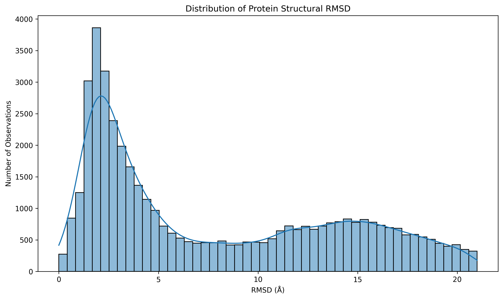
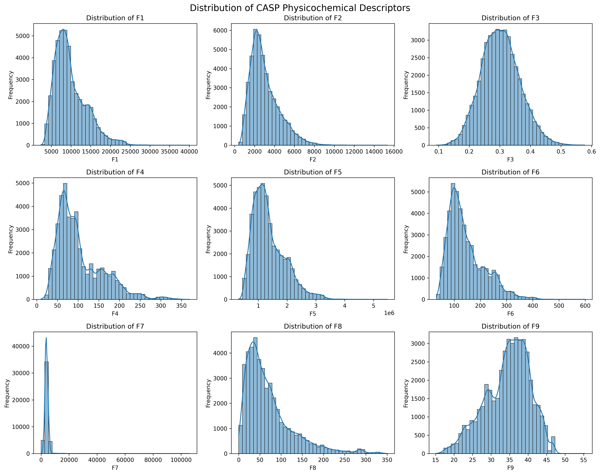

# 

# ProteinStruct-ML: Predicting Protein Structural Deviation Using Machine Learning

## Project Overview

Proteins are biological macromolecules involved in nearly every process occurring within living cells. Their functions depend not only on their amino acid sequences but also on the three-dimensional structures they adopt.

Understanding protein structure is therefore essential for investigating biological mechanisms, interpreting protein function, and supporting research in biotechnology, molecular biology, and drug discovery.

Experimentally determining protein structures can require substantial time and resources. Computational approaches provide an alternative by generating structural models, but these models can vary considerably in their accuracy.

Assessing the quality of predicted protein structures is consequently an important problem in structural bioinformatics.

This project investigates whether machine-learning algorithms can predict protein structural deviation using numerical descriptors associated with computational protein models.

The analysis uses the **CASP dataset**, which contains nine numerical input features (F1–F9) and a target variable representing structural deviation, expressed as Root Mean Square Deviation (RMSD).

The project follows a complete data-science workflow, including:

- data extraction, cleaning, and validation;
- exploratory data analysis and statistical testing;
- development and comparison of regression models;
- hyperparameter optimization and cross-validation;
- evaluation of predictive performance;
- and deployment of an interactive application using Streamlit and Heroku.

The final application allows users to explore the dataset, review model performance, and generate RMSD predictions from numerical input features.

## Understanding the Biological Context

### Protein Structure

Proteins consist of amino acids connected into polypeptide chains. These chains fold into three-dimensional structures that influence how proteins interact with other molecules and perform their biological functions.

Protein structure is commonly described at several organizational levels:

- **Primary structure:** The amino acid sequence.
- **Secondary structure:** Local structural arrangements such as alpha helices and beta sheets.
- **Tertiary structure:** The overall three-dimensional organization of a polypeptide chain.
- **Quaternary structure:** The arrangement of multiple polypeptide chains within a protein complex.

The three-dimensional organization of a protein is particularly important because changes in structural conformation can influence its biological activity.

### Experimental and Computational Protein Structures

Protein structures can be determined experimentally using techniques such as X-ray crystallography, nuclear magnetic resonance (NMR) spectroscopy, and cryogenic electron microscopy (cryo-EM).

Computational methods can also generate structural models based on amino acid sequences and other available information.

However, computational models are not necessarily identical to experimentally determined reference structures.

Evaluating the differences between predicted and reference structures is therefore important when assessing structural model quality.

### Root Mean Square Deviation (RMSD)

Root Mean Square Deviation is a commonly used measure of structural difference between corresponding atoms in two molecular structures.

After appropriate structural alignment, RMSD can be expressed as:

\[
\mathrm{RMSD} = \sqrt{\frac{1}{N}\sum_{i=1}^{N}\left\|\mathbf{r}_i-\mathbf{r}_i^{\mathrm{ref}}\right\|^2}
\]

where:

- \(N\) is the number of corresponding atoms;
- \(\mathbf{r}_i\) is the position of atom \(i\) in the evaluated structure;
- \(\mathbf{r}_i^{\mathrm{ref}}\) is the corresponding position in the reference structure.

RMSD is commonly expressed in ångströms (Å), where 1 Å equals 0.1 nanometres.

A smaller RMSD generally indicates greater structural similarity between the compared atomic coordinates, whereas a larger RMSD indicates greater structural deviation.

RMSD depends on the atoms selected, their correspondence, and the alignment procedure. It should therefore be interpreted in the context of how the structures were compared.

### Machine Learning for Structural Deviation Prediction

Machine learning provides methods for identifying statistical relationships between input variables and an outcome of interest.

In supervised regression, an algorithm learns from observations for which both the input features and the target values are known.

After training, the model can estimate the target variable for new observations.

In ProteinStruct-ML, the input consists of nine numerical descriptors (F1–F9), while RMSD is the continuous target variable.

The central question is whether these descriptors contain sufficient predictive information to estimate structural deviation with useful accuracy.

This project compares several regression approaches and evaluates their performance on data not used during model training.

## Project Objectives

The overall objective of ProteinStruct-ML is to investigate whether machine-learning algorithms can accurately estimate protein structural deviation (RMSD) using numerical descriptors from the CASP dataset.

The project combines exploratory statistical analysis with supervised machine learning to evaluate relationships between structural descriptors and RMSD.

The specific objectives are to:

1. **Prepare a reliable dataset:** Inspect the original CASP dataset for missing values, duplicate records, inconsistent data types, and potentially unusual observations.

2. **Explore structural descriptors:** Investigate the distributions of RMSD and the nine numerical features (F1–F9), identify extreme observations, and examine relationships between variables.

3. **Evaluate statistical relationships:** Use correlation analysis and hypothesis testing to determine whether selected descriptors are statistically associated with RMSD.

4. **Develop regression models:** Establish a baseline prediction using DummyRegressor and compare the performance of Linear Regression, Random Forest Regression, and HistGradientBoosting Regression.

5. **Optimize model performance:** Apply cross-validation and hyperparameter optimization to identify suitable model configurations.

## Research Questions

The project addresses five research questions:

1. **What are the main statistical characteristics of the CASP dataset?**

   How are RMSD and the nine numerical descriptors distributed? Are the variables approximately normally distributed, skewed, or affected by extreme observations?

2. **Which numerical descriptors are associated with RMSD?**

   Do the input features exhibit meaningful statistical relationships with structural deviation, and what do correlation analysis and hypothesis testing reveal about these associations?

3. **Can machine-learning algorithms predict RMSD more accurately than a simple baseline?**

   How do Linear Regression, Random Forest Regression, and HistGradientBoosting Regression perform compared with a baseline model that predicts a constant value?

4. **Does model optimization improve predictive performance?**

   Can cross-validation and hyperparameter tuning improve the predictive accuracy of the selected regression models?

5. **How reliably can the final model estimate RMSD for unseen observations?**

   What do the test-set MAE, RMSE, R², and residual analysis reveal about the model's accuracy, limitations, and potential generalization?

These questions provide the framework for interpreting the results of the ETL, EDA, and machine-learning notebooks.

## Dataset

The project uses the **CASP (Critical Assessment of protein Structure Prediction) protein tertiary structure dataset**.

CASP is an international initiative designed to evaluate computational methods for predicting protein three-dimensional structures.

The dataset contains numerical descriptors associated with computational protein models, together with a target variable representing their structural deviation.

The aim is to investigate whether relationships between these numerical descriptors and RMSD can be learned by regression algorithms.

### Dataset Structure

The original dataset contains **45,730 observations and 10 variables**.

| Variable | Description |
|---|---|
| `RMSD` | Root Mean Square Deviation, the continuous target variable |
| `F1` | Numerical input descriptor 1 |
| `F2` | Numerical input descriptor 2 |
| `F3` | Numerical input descriptor 3 |
| `F4` | Numerical input descriptor 4 |
| `F5` | Numerical input descriptor 5 |
| `F6` | Numerical input descriptor 6 |
| `F7` | Numerical input descriptor 7 |
| `F8` | Numerical input descriptor 8 |
| `F9` | Numerical input descriptor 9 |

The nine descriptors are supplied under generic feature names (F1–F9). Their precise physicochemical or structural interpretations are not established in the project notebooks, so no unsupported biological meaning is assigned to individual features.

### Target Variable: RMSD

RMSD is the variable the machine-learning models are trained to predict.

It represents a numerical measure of structural deviation and is expressed in ångströms (Å).

In general, lower RMSD values indicate greater similarity between the compared protein structures, whereas higher values indicate larger structural differences.

### Initial Dataset Characteristics

Initial inspection using Pandas revealed:

- **45,730 observations**
- **10 numerical variables**
- **9 predictor variables and 1 target variable**
- **No missing values**
- **Nine `float64` columns and one `int64` column (F8)**

The original RMSD values have the following descriptive statistics:

| Statistic | RMSD |
|---|---:|
| Mean | 7.75 Å |
| Median | 5.03 Å |
| Standard deviation | 6.12 Å |
| Minimum | 0.00 Å |
| Maximum | 21.00 Å |

The mean is higher than the median, suggesting a positively skewed RMSD distribution. This observation is investigated further during exploratory data analysis.

The numerical predictors also have substantially different scales. For example, F3 contains values below 1, while F5 contains values in the millions.

These differences are relevant when selecting preprocessing methods and machine-learning algorithms.

### Dataset Size After Cleaning

The data preparation process identified and removed 1,711 exact duplicate observations.

The cleaned dataset therefore contains **44,019 observations and 10 variables**.

The original dataset is stored in:

`data/raw/CASP.csv`

The cleaned dataset used for subsequent analysis is stored in:

`data/processed/casp_cleaned.csv`

Data Cleaning and Preparation

Before exploratory data analysis and machine-learning model development, the original CASP dataset was inspected and prepared in the 01_ETL.ipynb notebook.

The objective was to identify potential data-quality issues, investigate duplicate observations, and produce a validated dataset while preserving potentially meaningful scientific information.

1. Data Loading and Initial Inspection

The original dataset was loaded from data/raw/CASP.csv using Pandas.

Initial inspection included:

Displaying the first five observations using head().

Checking dataset dimensions using shape.

Examining data types and non-null counts using info().

Calculating descriptive statistics using describe().

The dataset contained 45,730 observations and 10 numerical columns, consisting of RMSD and nine predictor variables (F1–F9).

All columns contained non-null values. Nine columns had the float64 data type, while F8 was stored as int64.

Descriptive statistics revealed substantial differences in the scales of the predictors. Several variables also exhibited large differences between their median and maximum values, suggesting potentially extreme observations.

These characteristics were investigated further during exploratory data analysis.

2. Missing-Value Assessment

Missing values were checked using isnull().sum().

No missing values were detected in any of the ten variables.

Consequently, no missing-value imputation or row removal was necessary.

3. Investigation of Duplicate Observations

The dataset was examined for exact duplicate observations using duplicated().

The initial assessment identified:

Measure

Result

Original observations

45,730

Exact duplicates

1,711

Percentage duplicated

3.74%

Rows belonging to duplicate groups

3,162

Duplicate groups were inspected using duplicated(keep=False) and value_counts().

An additional investigation examined whether identical combinations of predictor values (F1–F9) were associated with different RMSD values.

This analysis identified 38 predictor combinations associated with more than one RMSD value.

These observations are not necessarily data-entry errors. They may reflect information not fully represented by the available numerical descriptors.

It was therefore important to distinguish between exact duplicate observations and observations with identical predictors but different target values.

4. Handling Duplicate Records

Only exact duplicate rows across all ten columns were removed using drop_duplicates().

This reduced the dataset from 45,730 to 44,019 observations.

The 38 predictor combinations associated with different RMSD values were retained.

Removing these observations would have required assuming that identical predictor values must correspond to identical RMSD values, which was not justified by the available information.

The original dataset was preserved separately.

No outlier removal, feature scaling, or additional transformations were performed during ETL.

5. Exporting the Cleaned Dataset

The cleaned dataset was exported to:

data/processed/casp_cleaned.csv

The original data remained available at:

data/raw/CASP.csv

Separating raw and processed data helps preserve reproducibility and allows the cleaning procedure to be reviewed independently.

6. Data Validation

After export, the cleaned CSV file was reloaded and checked.

The validation process confirmed:

Validation check

Result

Expected dimensions

44,019 × 10

Missing values

0

Exact duplicate observations

0

Expected column names

Preserved

Automated assertions

All passed

Automated assertions were used to verify dataset dimensions, missing-value counts, duplicate counts, and column consistency.

The cleaned dataset was subsequently used for exploratory data analysis and machine-learning model development.

Data Cleaning Conclusions

The ETL process removed 1,711 redundant observations while retaining records that shared predictor values but differed in RMSD.

The final dataset contained 44,019 observations and 10 numerical variables, with no missing values or exact duplicate records.

The investigation also highlighted the importance of considering repeated predictor combinations during machine-learning evaluation.

This finding motivated the use of group-aware data splitting and cross-validation in the modeling notebook to reduce the risk of information leakage between training and evaluation datasets.

## Exploratory Data Analysis

Exploratory Data Analysis (EDA) was performed in `02_EDA.ipynb` using the cleaned CASP dataset containing 44,019 observations.

The purpose of the analysis was to understand the statistical properties of RMSD and the nine numerical predictors (F1–F9), investigate potential outliers, examine relationships between variables, and identify considerations relevant to machine-learning model development.

The analysis included descriptive statistics, distribution plots, correlation analysis, and statistical hypothesis testing.

### 1. Distribution of RMSD

The first stage investigated the distribution of RMSD, the continuous target variable used for machine-learning regression.

A histogram with 50 bins and a kernel density estimate (KDE) was generated to visualize the frequency and distribution of RMSD values.



The histogram revealed a non-normal, apparently bimodal distribution, with two main concentrations of observations:

- A prominent concentration around 1.5–3 Å, representing relatively low structural deviations.
- A broader concentration around 14–16 Å, representing substantially higher structural deviations.

Fewer observations were present in the intermediate range of approximately 7–10 Å.

These observations suggest that the dataset contains distinct regions of structural deviation. However, the histogram alone does not establish the biological or computational reasons for this pattern.

#### Descriptive Statistics

The following statistics were calculated using Pandas:

| Statistic | Result |
|---|---:|
| Mean RMSD | 7.796 Å |
| Median RMSD | 5.087 Å |
| Standard deviation | 6.138 Å |
| Variance | 37.673 Ų |
| Skewness | 0.553 |
| Excess kurtosis | −1.162 |
| Observations with RMSD below 5 Å | 49.6% |

The mean RMSD is higher than the median, consistent with the moderately positive skewness of 0.553.

The standard deviation of 6.138 Å indicates substantial variability in structural deviation across the dataset.

The negative excess kurtosis indicates lower kurtosis than a normal distribution.

The empirical probability of observing RMSD below 5 Å was approximately 49.6%. This means that almost half of the observations had RMSD values below this threshold.

#### Implications for Machine Learning

The distribution of RMSD has several implications for predictive modeling.

First, the model must learn relationships across a broad range of structural deviations.

Second, prediction errors may vary between low-RMSD and high-RMSD observations. Therefore, overall evaluation metrics should be interpreted alongside residual analysis.

Third, the apparent bimodality suggests that a single linear relationship may not adequately describe the variation in RMSD.

These observations support comparing a simple linear regression model with more flexible nonlinear algorithms, including Random Forest and HistGradientBoosting Regression.

No target transformation was performed during exploratory analysis. The original RMSD values were retained for subsequent modeling.

### 2. Distribution of Input Features (F1–F9)

The nine numerical predictor variables (F1–F9) were examined to understand their distributions, variability, and potential extreme values.

These descriptors represent numerical characteristics associated with protein structural models in the CASP dataset. Their individual scientific definitions are not provided in the project dataset.

Understanding the distributions of these variables is important because their numerical scales, asymmetry, and extreme observations may influence machine-learning performance.

#### Visualization of Feature Distributions

Histograms with kernel density estimates (KDE) were generated for all nine predictors using Seaborn and Matplotlib.

The histograms were arranged in a **3 × 3 grid**, allowing direct comparison of the distributional characteristics of F1–F9.



*Figure: Distribution of the nine numerical descriptors (F1–F9) in the cleaned CASP dataset. Each histogram displays the frequency of observed values, while the KDE curve provides a smoothed representation of the distribution.*

#### Key Findings

The exploratory analysis revealed considerable differences between the distributions of the nine predictors.

**1. Right-Skewed Distributions**

Seven predictors — F1, F2, F4, F5, F6, F7, and F8 — exhibited varying degrees of positive skewness.

This indicates that their distributions have longer right-hand tails, with some observations substantially exceeding the values found in the main concentration of the data.

**2. Approximately Symmetric Distribution**

F3 exhibited a roughly bell-shaped distribution, suggesting a more balanced spread of observations around its central region.

**3. Complex Distribution**

F9 displayed an asymmetric distribution with multiple shoulders, indicating a more complex pattern than a simple symmetric distribution.

**4. Potential Extreme Values**

F7 contained particularly large upper-tail observations, with its maximum value exceeding 100,000.

These observations warranted further investigation to determine their frequency and potential implications for modeling.

#### Implications for Machine Learning

The differences between predictor distributions have several implications:

- **Feature scaling:** Predictors have substantially different numerical ranges. Standardization may benefit algorithms that are sensitive to feature scale.
- **Extreme values:** Unusually large observations can influence certain regression algorithms and may require further investigation.
- **Algorithm selection:** Tree-based algorithms, including Random Forest and HistGradientBoosting, are generally less sensitive to feature scaling than many distance-based or regularized models.
- **Feature transformations:** Transformations may be considered where appropriate, but should be evaluated within the training pipeline to avoid data leakage.
- **Data preservation:** Extreme observations should not automatically be removed without evidence that they represent errors.

No observations were removed solely because of their distributional characteristics.

The particularly large values observed in F7 were investigated separately in the next stage of exploratory analysis.

### 3. Investigation of Extreme Values in F7

The distribution analysis identified F7 as a descriptor containing particularly large values in its upper tail.

To investigate these observations, a more detailed statistical analysis was performed using percentiles and threshold-based counts.

The objective was to determine the extent of the extreme values and assess whether they should be retained for subsequent machine-learning development.

#### Statistical Investigation

The following percentiles were calculated using the Pandas `quantile()` method.

| Percentile | F7 Value |
|---|---:|
| 50th (Median) | 3,840.54 |
| 90th | 5,371.42 |
| 95th | 5,759.71 |
| 99th | 7,244.05 |
| 99.9th | 19,873.50 |
| Maximum | 105,948.17 |

The results indicate that most F7 values are concentrated within a substantially narrower range than the maximum observation.

For example, 99% of observations have F7 values at or below approximately 7,244, while the maximum reaches 105,948.

The maximum value is approximately **27.6 times greater than the median**, demonstrating the presence of an exceptionally long upper tail.

#### Frequency of Extreme Observations

To determine how frequently unusually large values occur, observations exceeding two thresholds were counted.

| Threshold | Number of Observations | Percentage of Dataset |
|---|---:|---:|
| F7 > 10,000 | 267 | 0.61% |
| F7 > 20,000 | 43 | 0.10% |

Only a small fraction of the dataset contains these extreme values.

Although uncommon, their presence may influence certain statistical and machine-learning algorithms.

#### Interpretation and Data Quality Considerations

An extreme numerical value is not necessarily an erroneous observation.

In scientific datasets, unusually large values may represent genuine variation, measurement artifacts, computational effects, or data-processing errors.

However, the available CASP dataset does not provide sufficient information to determine the scientific validity of individual extreme F7 observations.

Consequently, removing these records solely because they are statistically unusual would not be justified.

#### Implications for Machine Learning

Extreme values may affect regression algorithms differently.

- **Linear Regression:** Unusual predictor values can have high leverage and may substantially influence the fitted relationship.
- **Random Forest Regression:** Decision trees partition the feature space using thresholds and are generally less sensitive to numerical scaling.
- **HistGradientBoosting Regression:** Histogram-based feature binning can reduce sensitivity to the magnitude of extreme predictor values, although unusual observations may still influence predictions.

Potential transformations or robust preprocessing methods could be evaluated during model development if necessary.

Any preprocessing parameters learned from the data should be fitted using the training data only, avoiding information leakage into validation or test sets.

#### Final Decision

**All extreme F7 observations were retained in the cleaned dataset.**

No outlier removal or feature transformation was performed during the ETL or exploratory analysis stages.

This decision preserves the original numerical information while allowing the machine-learning models to be evaluated on the observed feature distributions.


Welcome,

This is the Code Institute student template for the three Data Analytics capstone projects. We have preinstalled all of the tools you need to get started. It's perfectly okay to use this template as the basis for your project submissions. Click the `Use this template` button above to get started.

You can safely delete the Template Instructions section of this README.md file and modify the remaining paragraphs for your own project. Please do read the Template Instructions at least once, though! It contains some important information about the IDE and the extensions we use.

If you are working on the first capstone project, you can also delete `.python-version`, `.slugignore`, `Procfile` and `setup.sh` as they are only required for later dashboard projects. 

## How to use this repo

1. Use this template to create your GitHub project repo. Click the **Use this template** button, then click **Create a new repository**.

1. Copy the URL of your repository to your clipboard.

1. In VS Code, select **File** -> **Open Folder**.

1. Select your `vscode-projects` folder, then click the **Select Folder** button on Windows, or the **Open** button on Mac.

1. From the top menu in VS Code, select **Terminal** > **New Terminal** to open a new terminal.

1. In the terminal, type `git clone` followed by the URL of your GitHub repository. Then hit **Enter**. This command will download all the files in your GitHub repository into your vscode-projects folder.

1. In VS Code, select **File** > **Open Folder** again.

1. This time, navigate to and select the folder for the project you just downloaded. Then, click **Select Folder**.

1. A virtual environment is necessary when working with Python projects to ensure each project's dependencies are kept separate. You need to create your virtual environment, also called a venv, and then activate it whenever you return to your workspace.
Click the gear icon in the lower left-hand corner of the screen to open the Manage menu and select **Command Palette** to open the VS Code command palette.

1. In the command palette, type: *create environment* and select **Python: Create Environment…**

1. Choose **Venv** from the dropdown list.

1. Choose the Python version you installed earlier. Currently, we recommend Python 3.12.8

1. **DO NOT** click the box next to `requirements.txt`; you need to complete additional steps before installing your dependencies. Click **OK**.

1. You will see a `.venv` folder appear in the file explorer pane, indicating that the virtual environment has been created.

1. **Important**: Note that the `.venv` folder is in the `.gitignore` file so that Git won't track it.

1. Return to the terminal by clicking on the TERMINAL tab, or click on the **Terminal** menu and choose **New Terminal** if no terminal is currently open.

1. In the terminal, use the command below to install your dependencies. This may take several minutes.

 ```console
 pip3 install -r requirements.txt
 ```

1. Open the `jupyter_notebooks` directory, and click on the notebook you want to open.

1. Click the **Kernel** button, then choose **Python Environments**.

Note that the kernel says `Python 3.12.8` as it inherits from the venv, so it will be Python-3.12.8 if that is what is installed on your PC. To confirm this, you can use the command below in a notebook code cell.

```console
! python --version
```

## Deployment Reminders

* The `.python-version`, `.slugignore`, `Procfile` and `setup.sh` files are necessary only if you are deploying a Streamlit app to Heroku as part of your submission for units 2 and 3. 
* Set the `.python-version` Python version to a [Heroku-22](https://devcenter.heroku.com/articles/python-support#supported-runtimes) stack, currently supported version that most closely matches what you used in this project.
* The project can be deployed to Heroku using the following steps.

1. Log in to Heroku and create an App
2. At the **Deploy** tab, select **GitHub** as the deployment method.
3. Select your repository name and click **Search**. Once it is found, click **Connect**.
4. Select the branch you want to deploy, then click **Deploy Branch**.
5. The deployment process should happen smoothly if all deployment files are fully functional. Click the button **Open App** at the top of the page to access your App.
6. If the slug size is too large, then add large files not required for the app to the `.slugignore` file.
